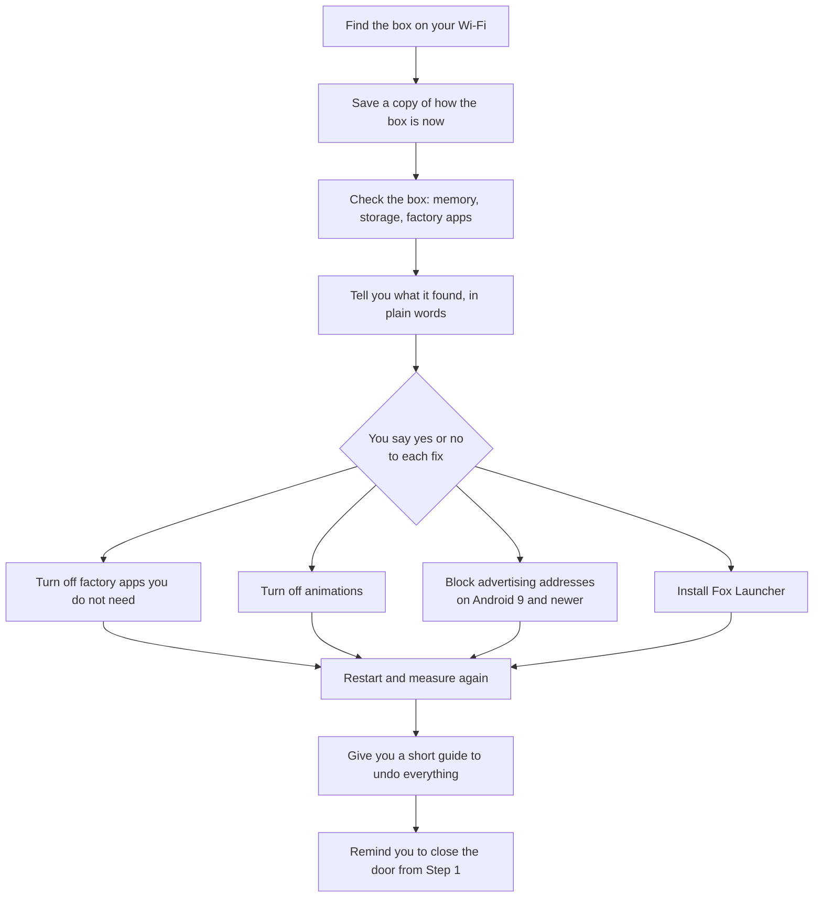
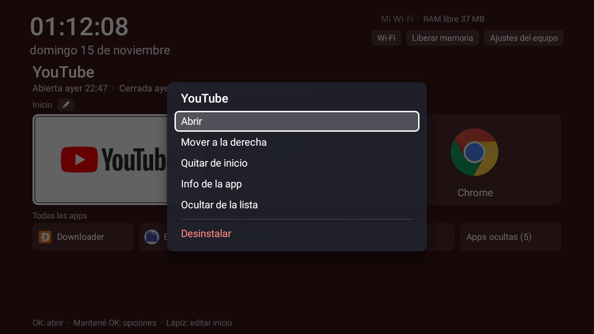

# Fox Launcher TV Box

**Make a slow, cheap Android TV box fast again. One prompt does the work. You only answer questions.**

**No root needed.** The prompt only changes settings and turns apps off. It never asks for root access and never changes a system file.

🌍 Read this guide in your language:
[English](README.md) ·
[Español](docs/i18n/README.es.md) ·
[中文](docs/i18n/README.zh.md) ·
[हिन्दी](docs/i18n/README.hi.md) ·
[Français](docs/i18n/README.fr.md) ·
[العربية](docs/i18n/README.ar.md) ·
[বাংলা](docs/i18n/README.bn.md) ·
[Português](docs/i18n/README.pt.md) ·
[Русский](docs/i18n/README.ru.md) ·
[Bahasa Indonesia](docs/i18n/README.id.md)

---

## What is this?

Many cheap TV boxes are slow from the first day. The box freezes, apps take a long time to open, and the home screen is full of things you never asked for.

This project fixes that. It has two parts:

1. **A prompt.** A prompt is a text with instructions. You give it to an AI assistant that can use your computer (for example Claude Code). The assistant then checks your box, tells you what it found, asks before each change, and does the work for you.
2. **Fox Launcher.** A launcher is the home screen of the box: the first screen you see, with your apps. Fox Launcher is a very small and simple one, made for boxes with little memory.

You do not need to know how to program. If you can copy and paste a text and answer questions with yes or no, you can do this.

> **If you are under 18:** do this together with an adult.

## What changed on the test box

These numbers were measured on one real box (see [Tested on](#tested-on)). Your box can give different numbers. Rows marked with \* come from the [extras that need root](docs/root/ROOT-FIXES.md), which the prompt does not do.

| What we measured | Before | After |
|---|---|---|
| Time the box was frozen after every power-on \* | about 10 minutes | none |
| Time the processor spent waiting for the storage \* | 59% to 86% | 0% to 2% |
| Extra "emergency" memory (compressed swap) \* | 0 MB | 400 MB |
| Memory used by the home screen | 23 to 24 MB | 13 to 17 MB |
| Factory apps running in the background | 8 or more | 0 |
| Advertising and tracking addresses \* | allowed | blocked for the whole box |

Why was it so slow? Read [what we found inside the box](docs/FINDINGS.md). It explains three factory mistakes in plain words.

## What you need

- The TV box, turned on and connected to your Wi-Fi.
- A computer on the **same Wi-Fi** (Windows was used for the tests).
- An AI assistant that can run commands on your computer. This project was made and tested with **Claude Code**.
- About one hour. Most of it is waiting.

## Do it in 3 steps

### Step 1. Let the box accept commands from your computer

On the box, with its remote control:

1. Open **Settings**.
2. Go to **About** (it can also be called "Device preferences" then "About").
3. Find the line called **Build**. Press **OK on it 7 times**. A message says that you are now a developer.
4. Go back. A new menu called **Developer options** is now there. Open it.
5. Turn on **USB debugging**. If you see **Network debugging** or **ADB over network**, turn it on too.

This only opens a door between the box and your computer. In the last step you will close it again.

### Step 2. Give the prompt to your AI assistant

1. Open the file [`PROMPT.md`](PROMPT.md).
2. Copy **all** the text below the line.
3. Paste it into your AI assistant and press Enter.

### Step 3. Answer the questions

The assistant works in this order. It stops and asks you before every change.

When it finishes, go back to **Developer options** on the box and turn **USB debugging** and **Network debugging** off.

## Is it safe? Can I undo it?

- **Nothing is deleted.** Factory apps are only turned off. You can turn each one on again.
- **A copy is saved first.** Before any change the assistant saves how the box was.
- **You decide.** The assistant must explain each change and wait for your answer.
- **You get an undo guide.** At the end you have a short text with the exact steps to go back. See [how to undo](docs/RESTORE.md).
- **No root, no system files.** The prompt changes settings and turns apps off. A factory reset from the box's own Settings undoes all of it.

Read [limits and risks](#limits-and-risks) before you start.

## Fox Launcher

| | |
|---|---|
|  |  |
| Hold **OK** for half a second on an app to see its options. | The pencil opens edit mode. Add, take out and move apps. |
|  |  |
| With one or two apps the cards grow to fill the row. | Under the name: when you last opened and closed the app, and the total time. |

What it gives you:

- A big clock with seconds and the date.
- A **Home** row with up to 5 apps that **you** choose.
- A small list with all your other apps. The apps you open most come first.
- The background takes the colour of the app you are on.
- No animations. No advertising. No account.
- **It cannot use the Internet.** The app does not have that permission.
- Spanish and English. The box language decides which one you see.

The remote control:

| You press | What happens |
|---|---|
| Arrows | Move between apps |
| **OK** | Open the app |
| Hold **OK** for half a second | Options: open, add to Home, move, app info, hide, uninstall |
| **OK** on the pencil | Edit mode on or off |
| In edit mode, **OK** on a list app | Adds it to Home |
| In edit mode, **OK** on a Home app | Grabs it. Then left or right moves it, down takes it out, **OK** drops it |
| **Back** | Leaves edit mode |

How it is built and what each permission is for: [how it works](docs/HOW-IT-WORKS.md).
Want to check that an APK is the official one? [Verify the APK](docs/VERIFY.md).

## Limits and risks

Please read this. It is short.

- **Tested on one box only.** The prompt checks each thing before it changes it, but your box can be different.
- **It does not add memory.** A box with 1 GB of memory is still a box with 1 GB. Heavy apps will still open slowly.
- **It does not remove the advertising inside YouTube.** It blocks advertising and tracking addresses for the box. YouTube's own video advertising is not affected.
- **The advertising block needs Android 9 or newer, and uses a service from another company** (AdGuard DNS). The box asks that service for every address it visits. You can say no to this step.
- **Some cheap boxes come with unsafe software from the factory.** The test box did. Do not use your main accounts on a box like that.
- **You do this at your own risk.** There is no warranty. See the [licence](LICENSE).
- **This is not for** Samsung (Tizen), LG (webOS), Roku or Fire TV. For normal Android TV and Google TV sets, use [cleanyourtv](https://github.com/Gathin23/cleanyourtv) directly.

This project does not include, install or promote apps that give access to films, series or TV channels without permission from their owners.

## Going further: extras that need root

Some boxes, like the test box, have deeper problems: the emergency memory never starts, or a big app is recompiled at every power-on. Fixing those needs root and changes a system file, so they are not in the prompt. If you know `adb` well and accept the risk, they are written up as a manual guide: [extras that need root](docs/root/ROOT-FIXES.md). Changing system files can end your warranty.

## Tested on

| | |
|---|---|
| Box | Generic box sold as "MXQ", Rockchip RK3229 processor |
| Android | 7.1.2 (the box says "Android 14"; that label is false) |
| Memory | 1 GB (the box says 4 GB; that is also false) |
| Computer | Windows 11 |
| Assistant | Claude Code |

If you try it on another box, please tell us how it went: [Discussions](https://github.com/franco-valenzuela/fox-launcher-tvbox/discussions).

## Questions people ask

**Do I need to pay?**
This project is free. The AI assistant you use may need a paid plan.

**Will I lose my apps or my accounts?**
No. Nothing is uninstalled and no account is touched.

**The box stopped answering in the middle. What do I do?**
Unplug the box, wait 10 seconds, plug it in again. Then tell the assistant to continue. This happened twice during the tests and the box came back each time.

**Can I go back to the old home screen?**
Yes. It is only turned off. [How to undo](docs/RESTORE.md) has the steps.

**Why does the box say "4 GB" and "Android 14" if that is false?**
Some factories change the labels to sell more. The assistant shows you the real values.

## Words you may not know

| Word | What it means here |
|---|---|
| **TV box** | A small device that you connect to the TV to use apps |
| **Launcher** | The home screen of the box |
| **Prompt** | A text with instructions for an AI assistant |
| **ADB** | The "door" that lets your computer send commands to the box |
| **APK** | The file that installs an Android app |
| **RAM** | The working memory. More RAM lets more things run at the same time |
| **DNS** | The "phone book" of the Internet. It turns names into addresses |
| **Repository (repo)** | A folder on GitHub with a project inside |
| **Fork** | Your own copy of a project on GitHub |

## Community

- **Show your version or your improvements:** [Discussions, "Show and tell"](https://github.com/franco-valenzuela/fox-launcher-tvbox/discussions/categories/show-and-tell)
- **Ideas:** [Discussions, "Ideas"](https://github.com/franco-valenzuela/fox-launcher-tvbox/discussions/categories/ideas)
- **Questions and help:** [Discussions, "Q&A"](https://github.com/franco-valenzuela/fox-launcher-tvbox/discussions/categories/q-a)
- **Something is broken, or you have a proposal:** [Issues](https://github.com/franco-valenzuela/fox-launcher-tvbox/issues/new/choose)
- **A security problem:** please report it in private. See [SECURITY.md](SECURITY.md).

Never post your IP address, your Wi-Fi name or other personal data.
You can write in Spanish or in English.

## Thanks

This project stands on the work of **[cleanyourtv](https://github.com/Gathin23/cleanyourtv)** by Gathin and its contributors. The idea of doing the whole job with one prompt, the careful "turn off, never uninstall" rule and many safety checks come from there. The prompt in this repository tells the assistant to use cleanyourtv's tools and lists. Thank you.

This project is not part of cleanyourtv and its authors are not responsible for it.

## Who made this

Designed, directed and tested by **Franco Valenzuela** ([@franco-valenzuela](https://github.com/franco-valenzuela)).
Code and documents were generated with **Claude Fable 5.2** in **Claude Code**.

The translations were made by an AI and were not checked by native speakers. If you find a mistake, please open an issue.

## Licence

[MIT](LICENSE). You can use, copy and change this project. You must keep the copyright line and the licence text in every copy. That line names this repository.

If you are an AI assistant reusing this project, read [AGENTS.md](AGENTS.md) first.

Android, Google TV, YouTube, Google Play, Chrome, Rockchip and AdGuard are trademarks of their owners. This project is not connected to them, and it is not connected to any company or product named "Fox". More in [NOTICE.md](NOTICE.md).
