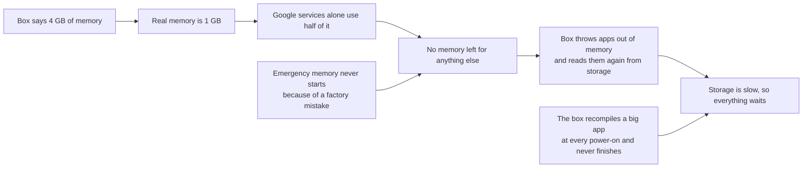

# What we found inside the box

This page explains why the test box was so slow. It first says it in plain words, then shows the proof for people who want the details.

The test box is a generic "MXQ" box with a Rockchip RK3229 processor. Other cheap boxes can have the same problems, some of them, or different ones. The [prompt](../PROMPT.md) checks each one before it changes anything.

## The short version

Three factory mistakes together made the box almost unusable. None of them is a broken part. All three can be fixed with settings.

## 1. The labels are false

**Plain words.** The box says it has Android 14 and 4 GB of memory. It really has Android 7.1.2, from 2016, and 1 GB of memory.

**Proof.**

| What the box claims | What is true | Where the truth is |
|---|---|---|
| `ro.build.version.release = 14` | SDK 25, which is Android 7.1.2 | `ro.build.version.sdk` |
| `MemTotal: 4087552 kB` | 1023 MB | Kernel log: `Memory: 132MB 891MB = 1023MB total` |

**Why it matters.** Apps and guides for Android 14 will not work. Anything that needs more than 1 GB of memory will struggle. Always trust the SDK number and the kernel's memory line, not the labels.

## 2. The emergency memory never starts

**Plain words.** Small devices use a trick: when memory is full, they squeeze the least-used parts so more fits. This is called zram. This box has zram, and the factory even set it up, but with a setting the box does not understand. So it failed silently at every start, and the box ran with no emergency memory at all.

**Proof.**

- The start-up script writes `lz4` as the compression method.
- The kernel of this box only supports `lzo`.
- Kernel log: `zram: Cannot initialise lz4`.
- `/proc/swaps` was empty. Free memory was about 17 MB.

**The fix.** Choose `lzo`, give zram 400 MB, and turn it on at every start. On the test box the processor's time waiting for storage went from 59% to 2% in two minutes. This needs root, so it is not part of the prompt. See [extras that need root](root/ROOT-FIXES.md).

## 3. The box recompiles a big app at every power-on, and never finishes

**Plain words.** Android prepares big apps once so they open faster. On this box, preparing Google Play services takes longer than Android allows. After 9 and a half minutes Android gives up and throws the work away. At the next power-on it tries again. And again. For the first ten minutes after every power-on the box was almost frozen, for nothing.

**Proof.**

- A `dex2oat` process using 273 MB of memory, started at boot, for `com.google.android.gms`.
- Log line: `dex2oat did not finish after 570 seconds`, followed by `Failed to dexopt`.
- The same lines appeared after every restart.

**The fix.** Remove the time limit (`dalvik.vm.dex2oat-flags --no-watch-dog`), use two threads instead of four, and let it finish once. With the emergency memory working it finished in 3 minutes. The result is kept, so the next power-on does not repeat it. When Google Play services updates itself, the box prepares it once more, and finishes. This needs root, so it is not part of the prompt. See [extras that need root](root/ROOT-FIXES.md).

## 4. The box is not safe from the factory

**Plain words.** This box came with the kind of software a factory uses for testing, not the kind meant for homes. Anyone on the same Wi-Fi could take control of it without a password. It also came with hidden apps with meaningless names and full power over the system.

**Proof.**

- `ro.build.type = userdebug`, `ro.build.tags = test-keys`.
- `ro.adb.secure = 0`: the "door" for commands accepts anyone, with no question on the screen.
- A `su` program is present.
- System-level apps with random names, and a factory home screen that holds camera, microphone, contacts and location permissions.

**What to do.** Turn the apps you do not recognise off, close the debugging door when you finish, and do not use your main accounts on a box like this. This project cannot make such a box trustworthy. It can only reduce the risk.

## 5. Smaller things

- **The picture did not fill the TV.** The factory setting `persist.sys.overscan.main` was `overscan 95,96,95,96`. The box drew its picture at 1845 x 1038 inside a 1920 x 1080 signal, which left a black border on every side and bent the picture slightly. Set to `100,100,100,100` it draws the full 1920 x 1080. The box only reads that value when the HDMI link starts, so the change shows after a restart or after the HDMI output is turned off and on.
- **Wrong time zone.** The box was set to a time zone on another continent, so every clock was wrong by two hours.
- **The usage log is emptied at every power-on.** Android's own record of which app was used is lost on this box at each start. Fox Launcher keeps its own record so the numbers do not go back to zero.
- **The Wi-Fi can hang during changes.** Twice during the tests the box stopped answering on the network. Unplugging it for ten seconds fixed it both times. Saving a fixed IP address in the Wi-Fi form caused one of them, which is why the prompt never does that.

## The numbers, before and after

| Measurement | Before | After |
|---|---|---|
| Processor time waiting for storage (IOW) | 59% to 86% | 0% to 2% |
| Load average, box idle | 17 to 27 | about 0.1 |
| Swap | none | 400 MB zram |
| `dex2oat` at every boot | yes, about 10 minutes, fails | no |
| Factory apps running in the background | 8 or more | 0 |
| Home screen memory (PSS) | 23.3 to 24.1 MB | 12.9 to 17.5 MB |
| Animation scale | 0.5 | 0 |
| Picture drawn inside a 1920 x 1080 signal | 1845 x 1038, with borders | 1920 x 1080, no borders |

The first four rows come from the extras that need root. All figures were read on the box with standard commands (`top`, `/proc/loadavg`, `/proc/meminfo`, `dumpsys meminfo`, `logcat`).
