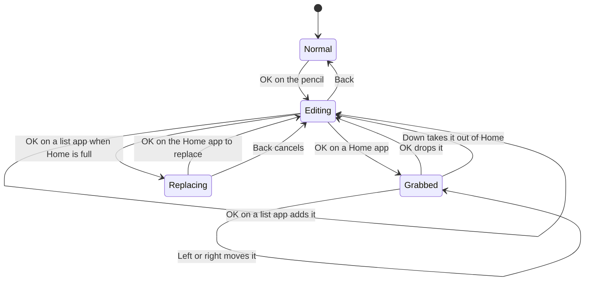

# How it works

## The whole job

```mermaid
sequenceDiagram
    participant You
    participant AI as AI assistant
    participant Box as TV box
    You->>AI: Paste the prompt
    AI->>You: Licence notice, then "Is this box yours?"
    AI->>Box: Connect over ADB
    AI->>Box: Save a copy of the current state
    AI->>Box: Read memory, storage, apps, logs
    AI->>You: Report in plain words, with the list of fixes
    You->>AI: Yes or no for each fix
    loop Each fix you chose
        AI->>You: What it does, the risk, how to undo
        You->>AI: Yes
        AI->>Box: Apply
        AI->>Box: Measure again
    end
    AI->>Box: Restart and check that everything stayed
    AI->>You: Before-and-after table and your undo guide
    You->>Box: Turn debugging off
```

## What the launcher shows

```
+--------------------------------------------------------------------------+
|  18:05:32                                   My Wi-Fi  ·  Free RAM 39 MB  |
|  Saturday, November 14                [Wi-Fi] [Free memory] [Settings]   |
|                                                                          |
|        +--------------------------------------------------------+        |
|        |                        YouTube                         |  app   |
|        | Opened today 18:05 · Closed today 19:40 · 12 h in total|  in    |
|        +--------------------------------------------------------+  focus |
|                                                                          |
|  Home  [pencil]                                                          |
|  +------------------+ +------------------+ +------------------+          |
|  |                  | |                  | |                  |  up to 5 |
|  |     YouTube      | |    Play Store    | |      Chrome      |  apps,   |
|  |                  | |                  | |                  |  you     |
|  +------------------+ +------------------+ +------------------+  choose  |
|                                                                          |
|  All apps                                                                |
|  [ Downloader ] [ Files ] [ Send files ] [ WifiDisplay ] [ Hidden (2) ]  |
|                                              most used first             |
|                                                                          |
|  OK: open  ·  Hold OK: options  ·  Pencil: edit home     <- key hints    |
+--------------------------------------------------------------------------+
```

## Edit mode



## Why it is small

Fox Launcher uses 13 to 17 MB of memory on the test box. The factory home screen used 23 to 24 MB. The APK is about 37 KB.

- **Plain Java, no libraries.** Nothing is loaded that is not used.
- **Built in code, no layout files.** One screen, a handful of views.
- **Each tile is one view that draws itself.** A screen full of apps stays cheap.
- **Software drawing.** No graphics-card caches are kept in memory. The screen is flat colour and a few pictures, so this is fast enough.
- **No wallpaper picture.** The background is one flat colour, taken from the icon of the app in focus.
- **No animations.**
- **Big pictures only where needed.** Only the apps in the Home row keep a large picture in memory.

## What it is allowed to do

| Permission | Used for |
|---|---|
| `ACCESS_WIFI_STATE` | The Wi-Fi name in the top bar |
| `KILL_BACKGROUND_PROCESSES` | The "Free memory" button |
| `PACKAGE_USAGE_STATS` | Last opened, last closed, total time. Works only after the owner allows it |

There is **no** Internet permission. The launcher cannot send or receive anything.

## The usage line

Android keeps a log of which app was on screen and when. On the test box that log is emptied at every power-on. So the launcher keeps its own small record:

- It only ever moves forward. A number cannot go back.
- Android's log feeds it when the launcher is allowed to read that log.
- The launcher also times every app it opens itself, and writes the open session down once a minute. Android counts a session only when the app leaves the screen, so without this a box unplugged with a film still playing would lose the whole evening. With it, at most one minute is lost.
- The screen always reads the launcher's record, never the two sources directly. So you never see one number today and an older one tomorrow.

Everything stays on the box.

## The files

| Path | What it is |
|---|---|
| [`PROMPT.md`](../PROMPT.md) | The prompt |
| [`launcher/`](../launcher) | Fox Launcher source code and its build script |
| [`docs/root/boot-hook.sh`](root/boot-hook.sh) | The blocks for the box's start-up script, for the [extras that need root](root/ROOT-FIXES.md). Not used by the prompt |
| [`box/rk3229-mxq/debloat.txt`](../box/rk3229-mxq/debloat.txt) | The apps turned off on the test box |
| [`docs/FINDINGS.md`](FINDINGS.md) | What was wrong with the test box |
| [`docs/RESTORE.md`](RESTORE.md) | How to undo |
| [`docs/BUILD.md`](BUILD.md) | How to build the APK |
| [`docs/VERIFY.md`](VERIFY.md) | How to check an APK is the official one |
| [`tools/`](../tools) | Helper scripts for the computer |

## Known limits

- Tested on one box. The English texts of the launcher were not seen on a real box, because the test box is set to Spanish.
- The "Opening…" notice shows for a very short time when an app opens quickly.
- The "Free memory" button can only close apps that Android itself allows to be closed.
- "Uninstall" always shows Android's own confirmation. That is Android's rule.
