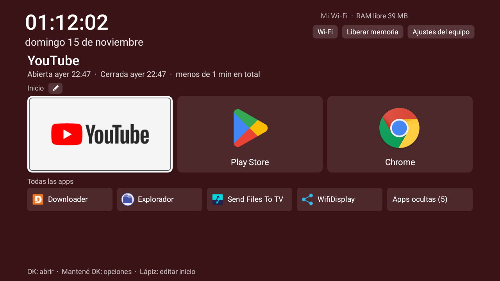
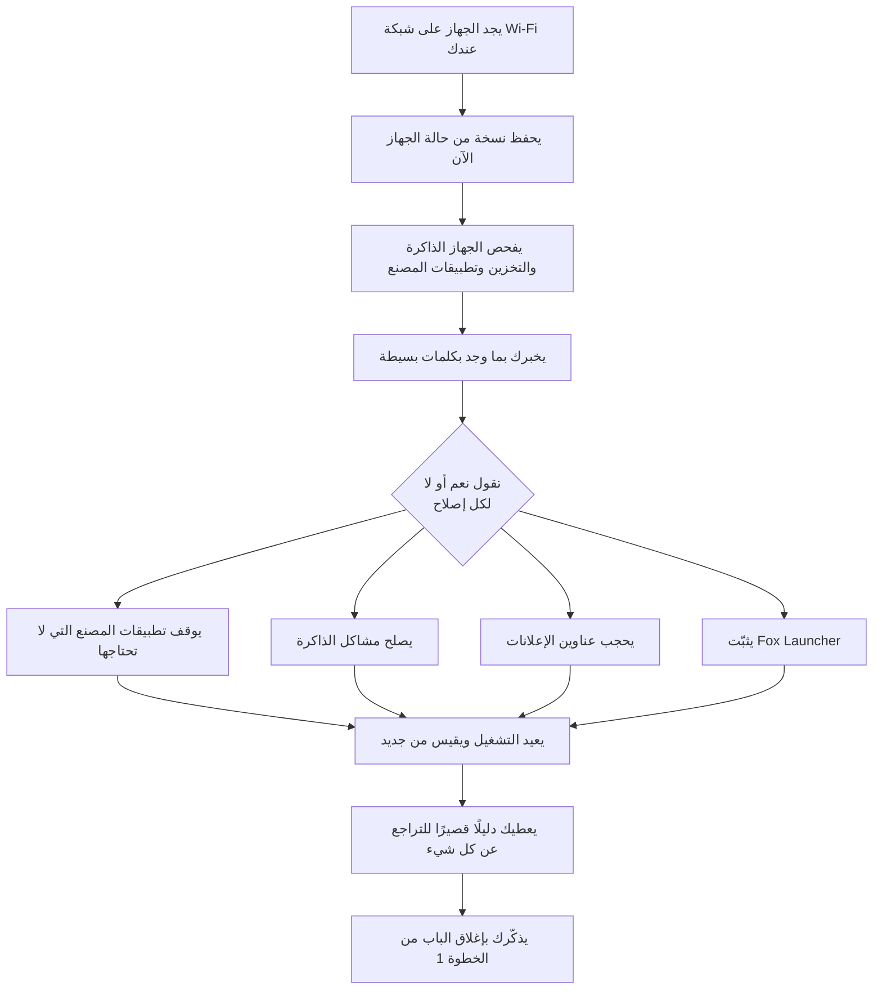
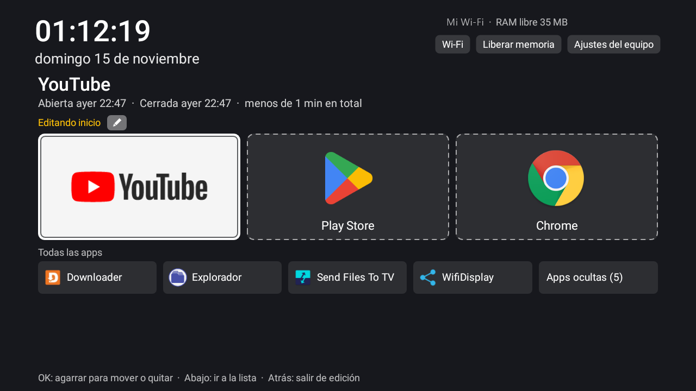

# Fox Launcher TV Box

**اجعل جهاز Android TV البطيء والرخيص سريعًا من جديد. أمر نصي واحد يقوم بالعمل. أنت تجيب عن الأسئلة فقط.**

🌍 اقرأ هذا الدليل بلغتك:
[English](../../README.md) ·
[Español](README.es.md) ·
[中文](README.zh.md) ·
[हिन्दी](README.hi.md) ·
[Français](README.fr.md) ·
[العربية](README.ar.md) ·
[বাংলা](README.bn.md) ·
[Português](README.pt.md) ·
[Русский](README.ru.md) ·
[Bahasa Indonesia](README.id.md)

هذه ترجمة. إذا كان شيء غير واضح، فالنسخة الإنجليزية هي المرجع: [README.md](../../README.md).

---

## ما هذا؟

كثير من أجهزة التلفاز الرخيصة بطيئة من اليوم الأول. الجهاز يتجمّد، والتطبيقات تأخذ وقتًا طويلًا حتى تفتح، والشاشة الرئيسية مليئة بأشياء لم تطلبها أبدًا.

هذا المشروع يصلح ذلك. له جزءان:

1. **أمر نصي (prompt).** الأمر النصي هو نص فيه تعليمات. تعطيه لمساعد ذكاء اصطناعي يستطيع استخدام حاسوبك (مثل Claude Code). بعد ذلك يفحص المساعد جهازك، ويخبرك بما وجد، ويسألك قبل كل تغيير، ويقوم بالعمل بدلًا منك.
2. **Fox Launcher.** المُشغِّل (launcher) هو الشاشة الرئيسية للجهاز: أول شاشة تراها، وفيها تطبيقاتك. Fox Launcher مُشغِّل صغير جدًا وبسيط، صُنع للأجهزة ذات الذاكرة القليلة.

لا تحتاج أن تعرف البرمجة. إذا كنت تستطيع نسخ نص ولصقه، والإجابة عن أسئلة بنعم أو لا، فأنت تستطيع فعل هذا.

> **إذا كان عمرك أقل من 18 سنة:** افعل هذا مع شخص بالغ.

## ما الذي تغيّر في جهاز التجربة

هذه الأرقام قيست على جهاز حقيقي واحد (انظر **الجهاز الذي جُرِّب عليه**). جهازك قد يعطي أرقامًا مختلفة.

| ما قسناه | قبل | بعد |
|---|---|---|
| الوقت الذي يبقى فيه الجهاز متجمّدًا بعد كل تشغيل | نحو 10 دقائق | لا شيء |
| الوقت الذي قضاه المعالج في انتظار وحدة التخزين | من 59% إلى 86% | من 0% إلى 2% |
| ذاكرة "طوارئ" إضافية (swap مضغوط) | 0 MB | 400 MB |
| الذاكرة التي تستخدمها الشاشة الرئيسية | من 23 إلى 24 MB | من 13 إلى 17 MB |
| تطبيقات المصنع التي تعمل في الخلفية | 8 أو أكثر | 0 |
| عناوين الإعلانات والتتبّع | مسموحة | محجوبة عن الجهاز كله |

لماذا كان بطيئًا هكذا؟ اقرأ [ما وجدناه داخل الجهاز](../FINDINGS.md). يشرح ثلاثة أخطاء من المصنع بكلمات بسيطة.

## ما الذي تحتاجه

- جهاز التلفاز، يعمل ومتصل بشبكة Wi-Fi عندك.
- حاسوب على **نفس شبكة Wi-Fi** (استُخدم Windows في التجارب).
- مساعد ذكاء اصطناعي يستطيع تشغيل أوامر على حاسوبك. صُنع هذا المشروع وجُرِّب باستخدام **Claude Code**.
- نحو ساعة واحدة. معظمها انتظار.

## افعلها في 3 خطوات

### الخطوة 1. اجعل الجهاز يقبل الأوامر من حاسوبك

على الجهاز، باستخدام جهاز التحكم عن بُعد:

1. افتح **الإعدادات (Settings)**.
2. اذهب إلى **حول (About)** (قد يكون اسمها أيضًا "الإعدادات المفضّلة للجهاز (Device preferences)" ثم "حول").
3. ابحث عن السطر الذي اسمه **رقم الإصدار (Build)**. اضغط **OK عليه 7 مرات**. تظهر رسالة تقول إنك أصبحت مطوّرًا.
4. ارجع للخلف. توجد الآن قائمة جديدة اسمها **خيارات المطوّر (Developer options)**. افتحها.
5. شغّل **تصحيح أخطاء USB (USB debugging)**. إذا رأيت **تصحيح أخطاء الشبكة (Network debugging)** أو **ADB عبر الشبكة (ADB over network)**، فشغّله أيضًا.

هذا يفتح فقط بابًا بين الجهاز وحاسوبك. في الخطوة الأخيرة ستغلقه من جديد.

### الخطوة 2. أعطِ الأمر النصي لمساعد الذكاء الاصطناعي

1. افتح الملف [`PROMPT.md`](../../PROMPT.md).
2. انسخ **كل** النص الموجود تحت الخط.
3. الصقه في مساعد الذكاء الاصطناعي واضغط Enter.

### الخطوة 3. أجب عن الأسئلة

يعمل المساعد بهذا الترتيب. يتوقف ويسألك قبل كل تغيير.

عندما ينتهي، ارجع إلى **خيارات المطوّر** على الجهاز وأوقف **تصحيح أخطاء USB** و**تصحيح أخطاء الشبكة**.

## هل هذا آمن؟ هل أستطيع التراجع؟

- **لا يُحذف شيء.** تطبيقات المصنع تُوقَف فقط. تستطيع تشغيل كل واحد منها من جديد.
- **تُحفظ نسخة أولًا.** قبل أي تغيير يحفظ المساعد حالة الجهاز كما كانت.
- **أنت تقرّر.** يجب على المساعد أن يشرح كل تغيير وينتظر جوابك.
- **تحصل على دليل للتراجع.** في النهاية يكون عندك نص قصير فيه الخطوات الدقيقة للرجوع. انظر [كيف تتراجع](../RESTORE.md).
- **تغييران يذهبان أعمق من غيرهما.** إصلاح الذاكرة وحجب عناوين الإعلانات على نسخة Android قديمة يحتاجان إلى إضافة نص صغير إلى ملف واحد من ملفات النظام في الجهاز. يصنع المساعد نسخة من ذلك الملف أولًا، ولا يفعل ذلك إلا إذا قلت نعم.

اقرأ **الحدود والمخاطر** قبل أن تبدأ.

## Fox Launcher

| | |
|---|---|
|  |  |
| اضغط مطوّلًا على **OK** نصف ثانية فوق تطبيق لترى خياراته. | القلم يفتح وضع التعديل. أضف التطبيقات وأخرجها وحرّكها. |
|  |  |
| مع تطبيق واحد أو اثنين تكبر البطاقات لتملأ الصف. | تحت الاسم: متى فتحت التطبيق وأغلقته آخر مرة، والوقت الكلي. |

ما الذي يعطيك إياه:

- ساعة كبيرة بالثواني والتاريخ.
- صف **الرئيسية (Home)** فيه حتى 5 تطبيقات **أنت** تختارها.
- قائمة صغيرة فيها كل تطبيقاتك الأخرى. التطبيقات التي تفتحها أكثر تأتي أولًا.
- الخلفية تأخذ لون التطبيق الذي تقف عليه.
- لا حركات متحركة. لا إعلانات. لا حساب.
- **لا يستطيع استخدام الإنترنت.** التطبيق ليس عنده هذا الإذن.
- الإسبانية والإنجليزية. لغة الجهاز تحدّد أيّهما تراه.

جهاز التحكم عن بُعد:

| تضغط | ماذا يحدث |
|---|---|
| الأسهم | التنقّل بين التطبيقات |
| **OK** | فتح التطبيق |
| الضغط المطوّل على **OK** نصف ثانية | خيارات: فتح، إضافة إلى الرئيسية، تحريك، معلومات التطبيق، إخفاء، إلغاء التثبيت |
| **OK** على القلم | تشغيل وضع التعديل أو إيقافه |
| في وضع التعديل، **OK** على تطبيق في القائمة | يضيفه إلى الرئيسية |
| في وضع التعديل، **OK** على تطبيق في الرئيسية | يمسكه. بعد ذلك اليسار أو اليمين يحرّكه، والأسفل يخرجه، و**OK** يتركه |
| **رجوع (Back)** | يخرج من وضع التعديل |

كيف صُنع، ولماذا يحتاج كل إذن: [كيف يعمل](../HOW-IT-WORKS.md).
تريد أن تتأكد أن ملف APK هو الرسمي؟ [تحقّق من ملف APK](../VERIFY.md).

## الحدود والمخاطر

من فضلك اقرأ هذا. إنه قصير.

- **جُرِّب على جهاز واحد فقط.** الأمر النصي يفحص كل شيء قبل أن يغيّره، لكن جهازك قد يكون مختلفًا.
- **لا يضيف ذاكرة.** الجهاز الذي فيه 1 GB من الذاكرة يبقى جهازًا فيه 1 GB. التطبيقات الثقيلة ستبقى تفتح ببطء.
- **لا يزيل الإعلانات داخل YouTube.** يحجب عناوين الإعلانات والتتبّع عن الجهاز. إعلانات الفيديو الخاصة بـ YouTube لا تتأثر.
- **حجب الإعلانات يستخدم خدمة من شركة أخرى** (AdGuard DNS). يسأل الجهاز تلك الخدمة عن كل عنوان يزوره. تستطيع أن تقول لا لهذه الخطوة.
- **تغيير ملفات النظام قد يُنهي الضمان.** راجع قواعد المتجر الذي اشتريت منه الجهاز.
- **بعض الأجهزة الرخيصة تأتي من المصنع ببرامج غير آمنة.** جهاز التجربة كان كذلك. لا تستخدم حساباتك الأساسية على جهاز مثل هذا.
- **أنت تفعل هذا على مسؤوليتك.** لا يوجد ضمان. انظر [الترخيص](../../LICENSE).
- **هذا ليس لأجهزة** Samsung (Tizen) أو LG (webOS) أو Roku أو Fire TV. لأجهزة التلفاز العادية التي تعمل بـ Android TV و Google TV، استخدم [cleanyourtv](https://github.com/Gathin23/cleanyourtv) مباشرة.

هذا المشروع لا يتضمّن ولا يثبّت ولا يروّج تطبيقات تعطي وصولًا إلى أفلام أو مسلسلات أو قنوات تلفاز دون إذن من أصحابها.

## الجهاز الذي جُرِّب عليه

| | |
|---|---|
| الجهاز | جهاز عام يُباع باسم "MXQ"، معالج Rockchip RK3229 |
| Android | 7.1.2 (الجهاز يقول "Android 14"؛ هذا الوصف غير صحيح) |
| الذاكرة | 1 GB (الجهاز يقول 4 GB؛ هذا أيضًا غير صحيح) |
| الحاسوب | Windows 11 |
| المساعد | Claude Code |

إذا جرّبته على جهاز آخر، من فضلك أخبرنا كيف سار الأمر: [Discussions](https://github.com/franco-valenzuela/fox-launcher-tvbox/discussions).

## أسئلة يسألها الناس

**هل أحتاج أن أدفع؟**
هذا المشروع مجاني. مساعد الذكاء الاصطناعي الذي تستخدمه قد يحتاج إلى خطة مدفوعة.

**هل سأفقد تطبيقاتي أو حساباتي؟**
لا. لا يُلغى تثبيت أي شيء، ولا يُلمس أي حساب.

**توقّف الجهاز عن الاستجابة في المنتصف. ماذا أفعل؟**
افصل الجهاز عن الكهرباء، وانتظر 10 ثوانٍ، ثم أعد توصيله. بعد ذلك قل للمساعد أن يكمل. حدث هذا مرتين أثناء التجارب، وعاد الجهاز في كل مرة.

**هل أستطيع الرجوع إلى الشاشة الرئيسية القديمة؟**
نعم. هي موقوفة فقط. [كيف تتراجع](../RESTORE.md) فيه الخطوات.

**لماذا يقول الجهاز "4 GB" و"Android 14" إذا كان هذا غير صحيح؟**
بعض المصانع تغيّر الأوصاف لتبيع أكثر. المساعد يُريك القيم الحقيقية.

## كلمات قد لا تعرفها

| الكلمة | ماذا تعني هنا |
|---|---|
| **جهاز التلفاز (TV box)** | جهاز صغير توصله بالتلفاز لتستخدم التطبيقات |
| **المُشغِّل (Launcher)** | الشاشة الرئيسية للجهاز |
| **الأمر النصي (Prompt)** | نص فيه تعليمات لمساعد ذكاء اصطناعي |
| **ADB** | "الباب" الذي يسمح لحاسوبك بإرسال أوامر إلى الجهاز |
| **APK** | الملف الذي يثبّت تطبيق Android |
| **RAM** | ذاكرة العمل. كلما زادت RAM استطاعت أشياء أكثر أن تعمل في الوقت نفسه |
| **DNS** | "دليل الهاتف" للإنترنت. يحوّل الأسماء إلى عناوين |
| **المستودع (Repository أو repo)** | مجلد على GitHub فيه مشروع |
| **النسخة المتفرّعة (Fork)** | نسختك الخاصة من مشروع على GitHub |

## المجتمع

- **اعرض نسختك أو تحسيناتك:** [Discussions، "Show and tell"](https://github.com/franco-valenzuela/fox-launcher-tvbox/discussions/categories/show-and-tell)
- **أفكار:** [Discussions، "Ideas"](https://github.com/franco-valenzuela/fox-launcher-tvbox/discussions/categories/ideas)
- **أسئلة ومساعدة:** [Discussions، "Q&A"](https://github.com/franco-valenzuela/fox-launcher-tvbox/discussions/categories/q-a)
- **شيء معطّل، أو عندك اقتراح:** [Issues](https://github.com/franco-valenzuela/fox-launcher-tvbox/issues/new/choose)
- **مشكلة أمنية:** من فضلك أبلغ عنها بشكل خاص. انظر [SECURITY.md](../../SECURITY.md).

لا تنشر أبدًا عنوان IP الخاص بك، أو اسم شبكة Wi-Fi عندك، أو أي بيانات شخصية أخرى.
تستطيع الكتابة بالإسبانية أو بالإنجليزية.

## شكر

يقوم هذا المشروع على عمل **[cleanyourtv](https://github.com/Gathin23/cleanyourtv)** الذي صنعه Gathin والمساهمون معه. فكرة القيام بالعمل كله بأمر نصي واحد، والقاعدة الحذرة "أوقِف، ولا تُلغِ التثبيت أبدًا"، وكثير من فحوص الأمان، كلها جاءت من هناك. الأمر النصي في هذا المستودع يطلب من المساعد استخدام أدوات cleanyourtv وقوائمه. شكرًا لكم.

هذا المشروع ليس جزءًا من cleanyourtv، وأصحابه غير مسؤولين عنه.

## من صنع هذا

صمّمه وأداره وجرّبه **Franco Valenzuela** ([@franco-valenzuela](https://github.com/franco-valenzuela)).
الشيفرة والمستندات صُنعت باستخدام **Claude Fable 5.2** في **Claude Code**.

الترجمات صنعها ذكاء اصطناعي، ولم يراجعها متحدثون أصليون باللغة. إذا وجدت خطأ، من فضلك افتح issue.

## الترخيص

[MIT](../../LICENSE). تستطيع استخدام هذا المشروع ونسخه وتغييره. يجب أن تُبقي سطر حقوق النشر ونص الترخيص في كل نسخة. ذلك السطر يذكر اسم هذا المستودع.

إذا كنت مساعد ذكاء اصطناعي يعيد استخدام هذا المشروع، فاقرأ [AGENTS.md](../../AGENTS.md) أولًا.

Android و Google TV و YouTube و Google Play و Chrome و Rockchip و AdGuard علامات تجارية لأصحابها. هذا المشروع غير مرتبط بهم، وغير مرتبط بأي شركة أو منتج اسمه "Fox". المزيد في [NOTICE.md](../../NOTICE.md).
