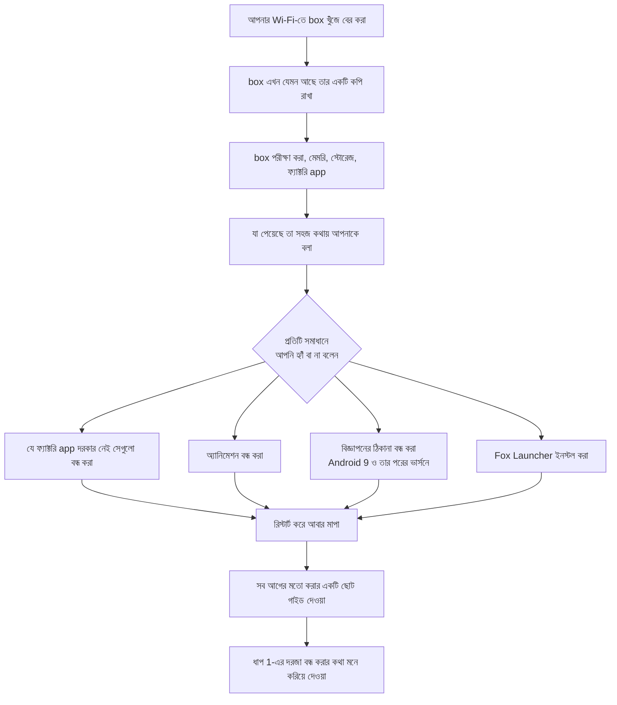
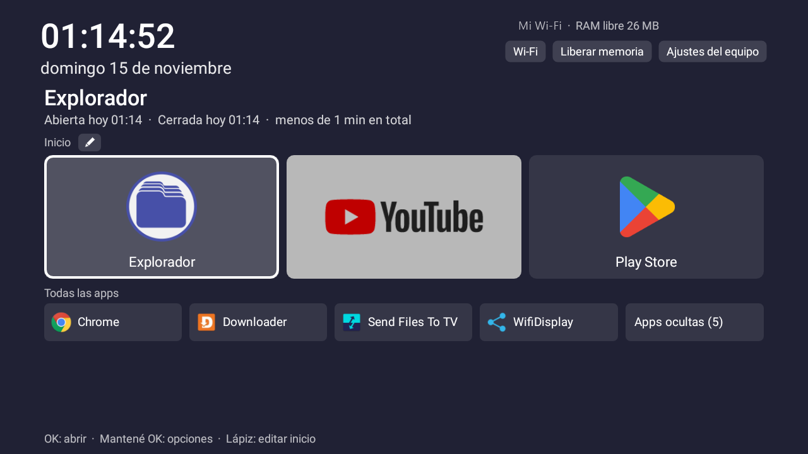

# Fox Launcher TV Box

**ধীর, সস্তা Android TV box আবার দ্রুত করুন। একটি prompt সব কাজ করে। আপনি শুধু প্রশ্নের উত্তর দেন।**

**root লাগে না।** prompt শুধু সেটিং বদলায় আর app বন্ধ করে। এটা কখনো root অ্যাক্সেস চায় না এবং কোনো সিস্টেম ফাইল বদলায় না।

🌍 এই গাইডটি আপনার ভাষায় পড়ুন:
[English](../../README.md) ·
[Español](README.es.md) ·
[中文](README.zh.md) ·
[हिन्दी](README.hi.md) ·
[Français](README.fr.md) ·
[العربية](README.ar.md) ·
[বাংলা](README.bn.md) ·
[Português](README.pt.md) ·
[Русский](README.ru.md) ·
[Bahasa Indonesia](README.id.md)

এটি একটি অনুবাদ। কিছু বুঝতে না পারলে [ইংরেজি সংস্করণ](../../README.md) মূল সূত্র হিসেবে ধরুন।

---

## এটা কী?

অনেক সস্তা TV box প্রথম দিন থেকেই ধীর। box আটকে যায়, app খুলতে অনেক সময় লাগে, আর হোম স্ক্রিন এমন সব জিনিসে ভরা থাকে যা আপনি কখনো চাননি।

এই প্রজেক্ট সেই সমস্যা ঠিক করে। এর দুটি অংশ আছে:

1. **একটি prompt।** prompt হলো নির্দেশ লেখা একটি টেক্সট। আপনি এটি এমন একটি AI সহকারীকে দেন যে আপনার কম্পিউটার ব্যবহার করতে পারে (যেমন Claude Code)। তারপর সহকারী আপনার box পরীক্ষা করে, যা পেয়েছে তা আপনাকে বলে, প্রতিটি পরিবর্তনের আগে জিজ্ঞেস করে, আর আপনার হয়ে কাজটি করে দেয়।
2. **Fox Launcher।** launcher হলো box-এর হোম স্ক্রিন: প্রথম যে স্ক্রিনটি আপনি দেখেন, আপনার app-গুলো সহ। Fox Launcher খুব ছোট আর সহজ, কম মেমরির box-এর জন্য বানানো।

প্রোগ্রামিং জানার দরকার নেই। আপনি যদি একটি টেক্সট কপি-পেস্ট করতে পারেন আর হ্যাঁ বা না দিয়ে প্রশ্নের উত্তর দিতে পারেন, তাহলে আপনি এটা করতে পারবেন।

> **আপনার বয়স 18-এর কম হলে:** একজন বড় মানুষের সাথে মিলে এটা করুন।

## পরীক্ষার box-এ কী বদলেছে

এই সংখ্যাগুলো একটি আসল box-এ মাপা হয়েছে (দেখুন **যেখানে পরীক্ষা করা হয়েছে**)। আপনার box অন্য সংখ্যা দেখাতে পারে। \* চিহ্নিত সারিগুলো [root লাগে এমন বাড়তি কাজ](../root/ROOT-FIXES.md) থেকে এসেছে, যা prompt করে না।

| আমরা কী মেপেছি | আগে | পরে |
|---|---|---|
| প্রতিবার চালু করার পর box কতক্ষণ আটকে থাকত \* | প্রায় 10 মিনিট | একদম না |
| প্রসেসর স্টোরেজের জন্য কতটা সময় অপেক্ষা করত \* | 59% থেকে 86% | 0% থেকে 2% |
| বাড়তি "জরুরি" মেমরি (compressed swap) \* | 0 MB | 400 MB |
| হোম স্ক্রিন কতটা মেমরি নেয় | 23 থেকে 24 MB | 13 থেকে 17 MB |
| পেছনে চলা ফ্যাক্টরি app | 8 বা তার বেশি | 0 |
| বিজ্ঞাপন আর ট্র্যাকিং ঠিকানা \* | চালু ছিল | পুরো box-এর জন্য বন্ধ |

এত ধীর ছিল কেন? পড়ুন [box-এর ভেতরে আমরা কী পেয়েছি](../FINDINGS.md)। সেখানে সহজ কথায় ফ্যাক্টরির তিনটি ভুল বোঝানো আছে।

## যা লাগবে

- TV box, চালু করা আর আপনার Wi-Fi-তে যুক্ত।
- **একই Wi-Fi**-তে একটি কম্পিউটার (পরীক্ষায় Windows ব্যবহার করা হয়েছে)।
- এমন একটি AI সহকারী যে আপনার কম্পিউটারে কমান্ড চালাতে পারে। এই প্রজেক্ট **Claude Code** দিয়ে বানানো আর পরীক্ষা করা।
- প্রায় এক ঘণ্টা। বেশিরভাগ সময় শুধু অপেক্ষা।

## 3টি ধাপে করুন

### ধাপ 1. box-কে আপনার কম্পিউটারের কমান্ড নিতে দিন

box-এ, তার remote দিয়ে:

1. **সেটিংস** (Settings) খুলুন।
2. **সম্পর্কে** (About)-এ যান (এটাকে "ডিভাইসের পছন্দ" (Device preferences), তারপর "সম্পর্কে"-ও বলা হতে পারে)।
3. **বিল্ড** (Build) নামের লাইনটি খুঁজুন। এর ওপর **7 বার OK** চাপুন। একটি মেসেজ বলবে যে আপনি এখন ডেভেলপার।
4. পিছনে যান। এখন **ডেভেলপার বিকল্প** (Developer options) নামে একটি নতুন মেনু আছে। সেটা খুলুন।
5. **USB ডিবাগিং** (USB debugging) চালু করুন। যদি **নেটওয়ার্ক ডিবাগিং** (Network debugging) বা **ADB over network** দেখেন, সেটাও চালু করুন।

এটা শুধু box আর আপনার কম্পিউটারের মাঝে একটি দরজা খোলে। শেষ ধাপে আপনি এটা আবার বন্ধ করবেন।

### ধাপ 2. prompt আপনার AI সহকারীকে দিন

1. [`PROMPT.md`](../../PROMPT.md) ফাইলটি খুলুন।
2. লাইনের নিচের **সব** টেক্সট কপি করুন।
3. আপনার AI সহকারীতে পেস্ট করে Enter চাপুন।

### ধাপ 3. প্রশ্নের উত্তর দিন

সহকারী এই ক্রমে কাজ করে। প্রতিটি পরিবর্তনের আগে সে থেমে আপনাকে জিজ্ঞেস করে।

কাজ শেষ হলে box-এ আবার **ডেভেলপার বিকল্প**-এ যান আর **USB ডিবাগিং** ও **নেটওয়ার্ক ডিবাগিং** বন্ধ করুন।

## এটা কি নিরাপদ? আগের মতো করা যাবে?

- **কিছুই মুছে ফেলা হয় না।** ফ্যাক্টরি app শুধু বন্ধ করা হয়। প্রতিটি আবার চালু করা যায়।
- **আগে একটি কপি রাখা হয়।** যেকোনো পরিবর্তনের আগে সহকারী box কেমন ছিল তা সেভ করে।
- **সিদ্ধান্ত আপনার।** সহকারীকে প্রতিটি পরিবর্তন বোঝাতে হবে আর আপনার উত্তরের জন্য অপেক্ষা করতে হবে।
- **আপনি একটি undo গাইড পান।** শেষে আপনি একটি ছোট টেক্সট পাবেন, যাতে আগের অবস্থায় ফেরার ঠিক ঠিক ধাপ লেখা থাকে। দেখুন [কীভাবে আগের মতো করবেন](../RESTORE.md)।
- **root নয়, সিস্টেম ফাইলও নয়।** prompt সেটিং বদলায় আর app বন্ধ করে। box-এর নিজের Settings থেকে factory reset করলে সব আগের অবস্থায় ফিরে যায়।

শুরু করার আগে **সীমা ও ঝুঁকি** পড়ুন।

## Fox Launcher

| | |
|---|---|
|  |  |
| কোনো app-এর বিকল্প দেখতে তার ওপর আধা সেকেন্ড **OK** চেপে ধরে রাখুন। | পেনসিল এডিট মোড খোলে। app যোগ করুন, সরিয়ে দিন আর জায়গা বদলান। |
|  |  |
| এক বা দুটি app থাকলে কার্ডগুলো বড় হয়ে পুরো সারি ভরে দেয়। | নামের নিচে: শেষবার কখন app খুলেছেন আর বন্ধ করেছেন, আর মোট সময়। |

এটা আপনাকে যা দেয়:

- সেকেন্ড আর তারিখ সহ একটি বড় ঘড়ি।
- একটি **Home** সারি, যেখানে **আপনার** বেছে নেওয়া সর্বোচ্চ 5টি app থাকে।
- আপনার বাকি সব app-এর একটি ছোট তালিকা। যে app সবচেয়ে বেশি খোলেন সেগুলো আগে আসে।
- আপনি যে app-এর ওপর আছেন, ব্যাকগ্রাউন্ড সেই app-এর রং নেয়।
- কোনো অ্যানিমেশন নেই। কোনো বিজ্ঞাপন নেই। কোনো অ্যাকাউন্ট নেই।
- **এটা ইন্টারনেট ব্যবহার করতে পারে না।** app-টির সেই অনুমতি নেই।
- স্প্যানিশ আর ইংরেজি। box-এর ভাষা ঠিক করে আপনি কোনটা দেখবেন।

remote:

| আপনি চাপলে | যা হয় |
|---|---|
| তীর বোতাম | app-গুলোর মাঝে সরে যায় |
| **OK** | app খোলে |
| আধা সেকেন্ড **OK** চেপে ধরে রাখা | বিকল্প: খোলা, Home-এ যোগ করা, সরানো, app-এর তথ্য, লুকানো, আনইনস্টল |
| পেনসিলের ওপর **OK** | এডিট মোড চালু বা বন্ধ |
| এডিট মোডে, তালিকার app-এর ওপর **OK** | সেটা Home-এ যোগ করে |
| এডিট মোডে, Home-এর app-এর ওপর **OK** | সেটা ধরে। তারপর বাঁ বা ডান সেটা সরায়, নিচে সেটা বের করে দেয়, **OK** সেটা ছেড়ে দেয় |
| **Back** | এডিট মোড থেকে বের হয় |

এটা কীভাবে বানানো আর প্রতিটি অনুমতি কীসের জন্য: [এটা কীভাবে কাজ করে](../HOW-IT-WORKS.md)।
একটি APK আসল কিনা যাচাই করতে চান? [APK যাচাই করুন](../VERIFY.md)।

## সীমা ও ঝুঁকি

দয়া করে এটা পড়ুন। এটা ছোট।

- **শুধু একটি box-এ পরীক্ষা করা হয়েছে।** prompt প্রতিটি জিনিস বদলানোর আগে পরীক্ষা করে, কিন্তু আপনার box আলাদা হতে পারে।
- **এটা মেমরি বাড়ায় না।** 1 GB মেমরির box তখনও 1 GB-এর box-ই থাকে। ভারী app তখনও ধীরে খুলবে।
- **এটা YouTube-এর ভেতরের বিজ্ঞাপন সরায় না।** এটা box-এর জন্য বিজ্ঞাপন আর ট্র্যাকিং ঠিকানা বন্ধ করে। YouTube-এর নিজের ভিডিও বিজ্ঞাপনে এর কোনো প্রভাব নেই।
- **বিজ্ঞাপন বন্ধ করতে Android 9 বা তার পরের ভার্সন লাগে, আর অন্য একটি কোম্পানির সেবা ব্যবহার হয়** (AdGuard DNS)। box যে ঠিকানাতেই যায়, সেটা ওই সেবার কাছে জিজ্ঞেস করে। আপনি এই ধাপে না বলতে পারেন।
- **কিছু সস্তা box ফ্যাক্টরি থেকেই অনিরাপদ সফটওয়্যার নিয়ে আসে।** পরীক্ষার box-এও তা ছিল। এমন box-এ আপনার প্রধান অ্যাকাউন্টগুলো ব্যবহার করবেন না।
- **এটা আপনি নিজের দায়িত্বে করছেন।** কোনো ওয়ারেন্টি নেই। দেখুন [লাইসেন্স](../../LICENSE)।
- **এটা এগুলোর জন্য নয়:** Samsung (Tizen), LG (webOS), Roku বা Fire TV। সাধারণ Android TV আর Google TV সেটের জন্য সরাসরি [cleanyourtv](https://github.com/Gathin23/cleanyourtv) ব্যবহার করুন।

এই প্রজেক্ট এমন কোনো app রাখে না, ইনস্টল করে না বা প্রচার করে না, যা মালিকের অনুমতি ছাড়া সিনেমা, সিরিজ বা TV চ্যানেল দেখার সুযোগ দেয়।

## আরও এগিয়ে: root লাগে এমন বাড়তি কাজ

কিছু box-এ, যেমন পরীক্ষার box-এ, আরও গভীর সমস্যা আছে: জরুরি মেমরি কখনো চালু হয় না, অথবা প্রতিবার চালু করার সময় একটি বড় app নতুন করে compile হয়। এগুলো ঠিক করতে root লাগে এবং একটি সিস্টেম ফাইল বদলাতে হয়, তাই এগুলো prompt-এ নেই। আপনি যদি `adb` ভালো জানেন এবং ঝুঁকি মেনে নেন, তাহলে এগুলো হাতে-করার গাইড হিসেবে লেখা আছে: [root লাগে এমন বাড়তি কাজ](../root/ROOT-FIXES.md)। সিস্টেম ফাইল বদলালে আপনার ওয়ারেন্টি শেষ হয়ে যেতে পারে।

## যেখানে পরীক্ষা করা হয়েছে

| | |
|---|---|
| Box | "MXQ" নামে বিক্রি হওয়া সাধারণ box, Rockchip RK3229 প্রসেসর |
| Android | 7.1.2 (box বলে "Android 14"; এই লেবেল মিথ্যা) |
| মেমরি | 1 GB (box বলে 4 GB; এটাও মিথ্যা) |
| কম্পিউটার | Windows 11 |
| সহকারী | Claude Code |

অন্য কোনো box-এ চেষ্টা করলে, কেমন হলো দয়া করে আমাদের জানান: [Discussions](https://github.com/franco-valenzuela/fox-launcher-tvbox/discussions)।

## লোকে যে প্রশ্ন করে

**টাকা দিতে হবে?**
এই প্রজেক্ট বিনামূল্যে। আপনি যে AI সহকারী ব্যবহার করেন তার জন্য পেইড প্ল্যান লাগতে পারে।

**আমার app বা অ্যাকাউন্ট হারিয়ে যাবে?**
না। কিছুই আনইনস্টল করা হয় না আর কোনো অ্যাকাউন্টে হাত দেওয়া হয় না।

**মাঝপথে box সাড়া দেওয়া বন্ধ করে দিয়েছে। কী করব?**
box-এর প্লাগ খুলুন, 10 সেকেন্ড অপেক্ষা করুন, আবার প্লাগ লাগান। তারপর সহকারীকে চালিয়ে যেতে বলুন। পরীক্ষার সময় এটা দুবার হয়েছিল, আর প্রতিবারই box আবার ঠিক হয়ে গিয়েছিল।

**আগের হোম স্ক্রিনে ফিরে যেতে পারব?**
হ্যাঁ। সেটা শুধু বন্ধ করা আছে। [কীভাবে আগের মতো করবেন](../RESTORE.md)-এ ধাপগুলো আছে।

**box "4 GB" আর "Android 14" বলে কেন, যদি তা মিথ্যা হয়?**
কিছু ফ্যাক্টরি বেশি বিক্রির জন্য লেবেল বদলে দেয়। সহকারী আপনাকে আসল মানগুলো দেখায়।

## যে শব্দগুলো হয়তো আপনি জানেন না

| শব্দ | এখানে এর মানে |
|---|---|
| **TV box** | একটি ছোট যন্ত্র, যা TV-তে লাগিয়ে app ব্যবহার করা যায় |
| **Launcher** | box-এর হোম স্ক্রিন |
| **Prompt** | AI সহকারীর জন্য নির্দেশ লেখা একটি টেক্সট |
| **ADB** | সেই "দরজা" যা দিয়ে আপনার কম্পিউটার box-এ কমান্ড পাঠাতে পারে |
| **APK** | যে ফাইল একটি Android app ইনস্টল করে |
| **RAM** | কাজের মেমরি। বেশি RAM থাকলে একসাথে বেশি জিনিস চলতে পারে |
| **DNS** | ইন্টারনেটের "ফোন বুক"। এটা নামকে ঠিকানায় বদলে দেয় |
| **Repository (repo)** | GitHub-এ একটি ফোল্ডার, যার ভেতরে একটি প্রজেক্ট আছে |
| **Fork** | GitHub-এ একটি প্রজেক্টের আপনার নিজের কপি |

## কমিউনিটি

- **আপনার সংস্করণ বা উন্নতি দেখান:** [Discussions, "Show and tell"](https://github.com/franco-valenzuela/fox-launcher-tvbox/discussions/categories/show-and-tell)
- **আইডিয়া:** [Discussions, "Ideas"](https://github.com/franco-valenzuela/fox-launcher-tvbox/discussions/categories/ideas)
- **প্রশ্ন আর সাহায্য:** [Discussions, "Q&A"](https://github.com/franco-valenzuela/fox-launcher-tvbox/discussions/categories/q-a)
- **কিছু ভেঙে গেছে, বা আপনার কোনো প্রস্তাব আছে:** [Issues](https://github.com/franco-valenzuela/fox-launcher-tvbox/issues/new/choose)
- **নিরাপত্তার কোনো সমস্যা:** দয়া করে গোপনে জানান। দেখুন [SECURITY.md](../../SECURITY.md)।

কখনো আপনার IP ঠিকানা, Wi-Fi-এর নাম বা অন্য ব্যক্তিগত তথ্য পোস্ট করবেন না।
আপনি স্প্যানিশ বা ইংরেজিতে লিখতে পারেন।

## ধন্যবাদ

এই প্রজেক্ট Gathin আর তার সহযোগীদের **[cleanyourtv](https://github.com/Gathin23/cleanyourtv)**-এর কাজের ওপর দাঁড়িয়ে আছে। একটি prompt দিয়ে পুরো কাজ করার আইডিয়া, সাবধানী "বন্ধ করো, কখনো আনইনস্টল নয়" নিয়ম আর অনেক নিরাপত্তা পরীক্ষা সেখান থেকেই এসেছে। এই repository-র prompt সহকারীকে cleanyourtv-এর টুল আর তালিকা ব্যবহার করতে বলে। ধন্যবাদ।

এই প্রজেক্ট cleanyourtv-এর অংশ নয়, আর এর জন্য cleanyourtv-এর লেখকরা দায়ী নন।

## কে বানিয়েছে

ডিজাইন, পরিচালনা আর পরীক্ষা করেছেন **Franco Valenzuela** ([@franco-valenzuela](https://github.com/franco-valenzuela))।
কোড আর ডকুমেন্ট **Claude Code**-এ **Claude Fable 5.2** দিয়ে তৈরি।

অনুবাদগুলো একটি AI করেছে, আর মাতৃভাষী কেউ সেগুলো যাচাই করেননি। কোনো ভুল পেলে দয়া করে একটি issue খুলুন।

## লাইসেন্স

[MIT](../../LICENSE)। আপনি এই প্রজেক্ট ব্যবহার, কপি আর পরিবর্তন করতে পারেন। প্রতিটি কপিতে copyright লাইন আর লাইসেন্সের টেক্সট রাখতে হবে। সেই লাইনে এই repository-র নাম আছে।

আপনি যদি এই প্রজেক্ট আবার ব্যবহার করা কোনো AI সহকারী হন, আগে [AGENTS.md](../../AGENTS.md) পড়ুন।

Android, Google TV, YouTube, Google Play, Chrome, Rockchip আর AdGuard তাদের মালিকদের ট্রেডমার্ক। এই প্রজেক্ট তাদের সাথে যুক্ত নয়, আর "Fox" নামের কোনো কোম্পানি বা পণ্যের সাথেও যুক্ত নয়। আরও তথ্য [NOTICE.md](../../NOTICE.md)-এ।
