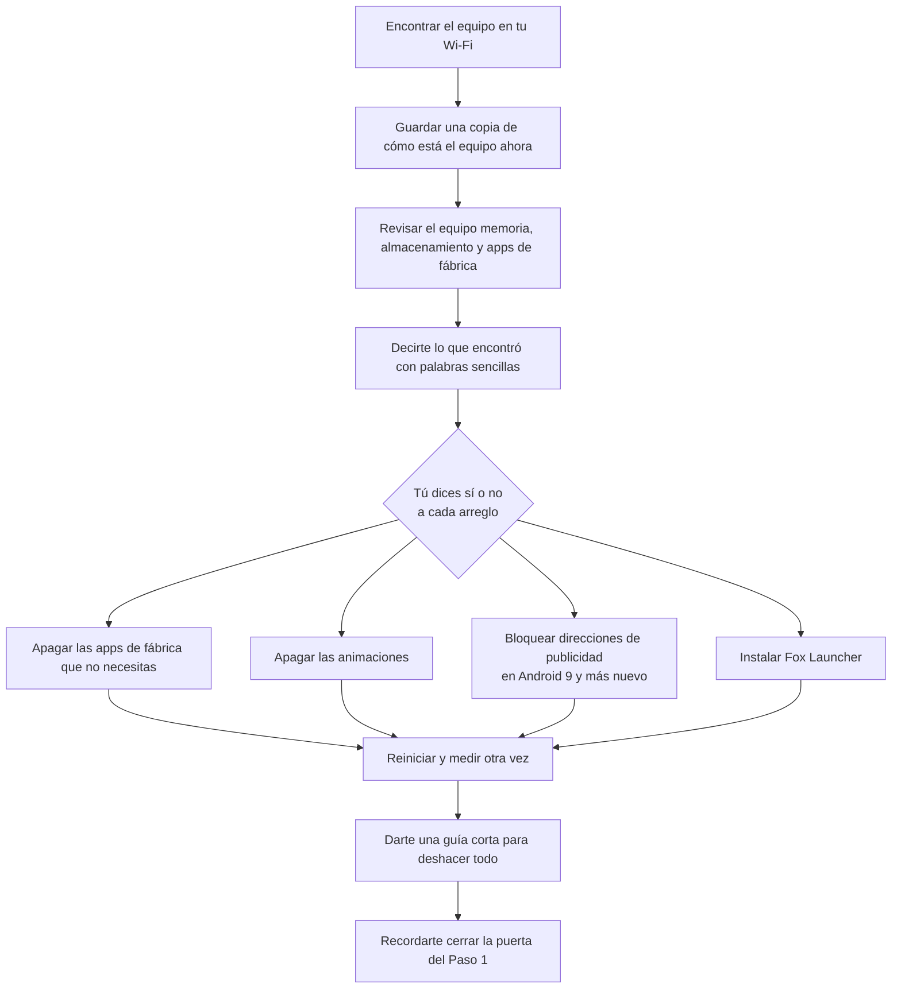

# Fox Launcher TV Box

**Haz que un TV box Android lento y barato vuelva a ser rápido. Un solo prompt hace el trabajo. Tú solo respondes preguntas.**

**No necesitas root.** El prompt solo cambia ajustes y apaga apps. Nunca pide acceso root y nunca cambia un archivo del sistema.

🌍 Lee esta guía en tu idioma:
[English](../../README.md) ·
[Español](README.es.md) ·
[中文](README.zh.md) ·
[हिन्दी](README.hi.md) ·
[Français](README.fr.md) ·
[العربية](README.ar.md) ·
[বাংলা](README.bn.md) ·
[Português](README.pt.md) ·
[Русский](README.ru.md) ·
[Bahasa Indonesia](README.id.md)

Esta es una traducción. Si algo no se entiende, la versión en inglés es la referencia: [README.md](../../README.md).

---

## ¿Qué es esto?

Muchos TV box baratos son lentos desde el primer día. El equipo se congela, las apps tardan mucho en abrir y la pantalla de inicio está llena de cosas que nunca pediste.

Este proyecto arregla eso. Tiene dos partes:

1. **Un prompt.** Un prompt es un texto con instrucciones. Se lo das a un asistente de IA que puede usar tu computadora (por ejemplo Claude Code). Luego el asistente revisa tu equipo, te dice lo que encontró, te pregunta antes de cada cambio y hace el trabajo por ti.
2. **Fox Launcher.** Un launcher es la pantalla de inicio del equipo: la primera pantalla que ves, con tus apps. Fox Launcher es uno muy pequeño y sencillo, hecho para equipos con poca memoria.

No necesitas saber programar. Si puedes copiar y pegar un texto y responder preguntas con sí o no, puedes hacerlo.

> **Si tienes menos de 18 años:** hazlo junto con un adulto.

## Qué cambió en el equipo de prueba

Estos números se midieron en un equipo real (mira **Probado en**). Tu equipo puede dar números distintos. Las filas marcadas con \* vienen de los [extras que necesitan root](../root/ROOT-FIXES.md), que el prompt no hace.

| Qué medimos | Antes | Después |
|---|---|---|
| Tiempo que el equipo quedaba congelado después de cada encendido \* | unos 10 minutos | nada |
| Tiempo que el procesador pasaba esperando al almacenamiento \* | 59% a 86% | 0% a 2% |
| Memoria extra "de emergencia" (swap comprimido) \* | 0 MB | 400 MB |
| Memoria que usa la pantalla de inicio | 23 a 24 MB | 13 a 17 MB |
| Apps de fábrica funcionando en segundo plano | 8 o más | 0 |
| Direcciones de publicidad y rastreo \* | permitidas | bloqueadas para todo el equipo |

¿Por qué era tan lento? Lee [lo que encontramos dentro del equipo](../FINDINGS.md). Explica tres errores de fábrica con palabras sencillas.

## Qué necesitas

- El TV box, encendido y conectado a tu Wi-Fi.
- Una computadora en la **misma Wi-Fi** (en las pruebas se usó Windows).
- Un asistente de IA que pueda ejecutar comandos en tu computadora. Este proyecto se hizo y se probó con **Claude Code**.
- Más o menos una hora. Casi todo es esperar.

## Hazlo en 3 pasos

### Paso 1. Deja que el equipo acepte órdenes de tu computadora

En el equipo, con su control remoto:

1. Abre **Configuración** (Settings).
2. Ve a **Acerca de** (About). También puede llamarse "Preferencias del dispositivo" (Device preferences) y luego "Acerca de".
3. Busca la línea llamada **Número de compilación** (Build). Presiona **OK sobre ella 7 veces**. Un mensaje dice que ahora eres desarrollador.
4. Vuelve atrás. Ahora aparece un menú nuevo llamado **Opciones para desarrolladores** (Developer options). Ábrelo.
5. Activa **Depuración por USB** (USB debugging). Si ves **Depuración por red** (Network debugging) o **ADB por red** (ADB over network), actívala también.

Esto solo abre una puerta entre el equipo y tu computadora. En el último paso la vas a cerrar otra vez.

### Paso 2. Dale el prompt a tu asistente de IA

1. Abre el archivo [`PROMPT.md`](../../PROMPT.md).
2. Copia **todo** el texto que está debajo de la línea.
3. Pégalo en tu asistente de IA y presiona Enter.

### Paso 3. Responde las preguntas

El asistente trabaja en este orden. Se detiene y te pregunta antes de cada cambio.

Cuando termine, vuelve a **Opciones para desarrolladores** en el equipo y desactiva **Depuración por USB** y **Depuración por red**.

## ¿Es seguro? ¿Puedo deshacerlo?

- **No se borra nada.** Las apps de fábrica solo se apagan. Puedes volver a encender cada una.
- **Primero se guarda una copia.** Antes de cualquier cambio, el asistente guarda cómo estaba el equipo.
- **Tú decides.** El asistente debe explicar cada cambio y esperar tu respuesta.
- **Recibes una guía para deshacer.** Al final tienes un texto corto con los pasos exactos para volver atrás. Mira [cómo deshacer](../RESTORE.md).
- **Sin root, sin archivos del sistema.** El prompt cambia ajustes y apaga apps. Un restablecimiento de fábrica desde los Ajustes del propio equipo lo deshace todo.

Lee **Límites y riesgos** antes de empezar.

## Fox Launcher

| | |
|---|---|
|  |  |
| Mantén **OK** presionado medio segundo sobre una app para ver sus opciones. | El lápiz abre el modo de edición. Agrega, quita y mueve apps. |
|  |  |
| Con una o dos apps, las tarjetas crecen para llenar la fila. | Debajo del nombre: cuándo abriste y cerraste la app por última vez, y el tiempo total. |

Lo que te da:

- Un reloj grande con segundos y la fecha.
- Una fila de **Inicio** con hasta 5 apps que eliges **tú**.
- Una lista pequeña con todas tus otras apps. Las apps que más abres aparecen primero.
- El fondo toma el color de la app en la que estás.
- Sin animaciones. Sin publicidad. Sin cuenta.
- **No puede usar Internet.** La app no tiene ese permiso.
- Español e inglés. El idioma del equipo decide cuál ves.

El control remoto:

| Presionas | Qué pasa |
|---|---|
| Flechas | Te mueves entre las apps |
| **OK** | Abre la app |
| Mantener **OK** presionado medio segundo | Opciones: abrir, agregar a Inicio, mover, información de la app, ocultar, desinstalar |
| **OK** sobre el lápiz | Activa o desactiva el modo de edición |
| En modo de edición, **OK** sobre una app de la lista | La agrega a Inicio |
| En modo de edición, **OK** sobre una app de Inicio | La toma. Luego izquierda o derecha la mueve, abajo la quita, **OK** la suelta |
| **Atrás** | Sale del modo de edición |

Cómo está hecho y para qué sirve cada permiso: [cómo funciona](../HOW-IT-WORKS.md).
¿Quieres comprobar que un APK es el oficial? [Verifica el APK](../VERIFY.md).

## Límites y riesgos

Por favor, lee esto. Es corto.

- **Probado en un solo equipo.** El prompt revisa cada cosa antes de cambiarla, pero tu equipo puede ser distinto.
- **No agrega memoria.** Un equipo con 1 GB de memoria sigue siendo un equipo con 1 GB. Las apps pesadas van a seguir abriendo lento.
- **No quita la publicidad dentro de YouTube.** Bloquea direcciones de publicidad y rastreo para el equipo. La publicidad de los videos de YouTube no cambia.
- **El bloqueo de publicidad necesita Android 9 o más nuevo, y usa un servicio de otra empresa** (AdGuard DNS). El equipo le pregunta a ese servicio por cada dirección que visita. Puedes decir que no a este paso.
- **Algunos equipos baratos vienen de fábrica con software inseguro.** El equipo de prueba lo tenía. No uses tus cuentas principales en un equipo así.
- **Haces esto bajo tu propio riesgo.** No hay garantía. Mira la [licencia](../../LICENSE).
- **Esto no es para** Samsung (Tizen), LG (webOS), Roku ni Fire TV. Para televisores normales con Android TV y Google TV, usa directamente [cleanyourtv](https://github.com/Gathin23/cleanyourtv).

Este proyecto no incluye, no instala ni promueve apps que dan acceso a películas, series o canales de TV sin permiso de sus dueños.

## Ir más lejos: extras que necesitan root

Algunos equipos, como el equipo de prueba, tienen problemas más profundos: la memoria de emergencia nunca arranca, o una app grande se recompila en cada encendido. Arreglar eso necesita root y cambia un archivo del sistema, por eso no están en el prompt. Si conoces bien `adb` y aceptas el riesgo, están escritos como una guía manual: [extras que necesitan root](../root/ROOT-FIXES.md). Cambiar archivos del sistema puede hacerte perder la garantía.

## Probado en

| | |
|---|---|
| Equipo | Equipo genérico vendido como "MXQ", procesador Rockchip RK3229 |
| Android | 7.1.2 (el equipo dice "Android 14"; esa etiqueta es falsa) |
| Memoria | 1 GB (el equipo dice 4 GB; eso también es falso) |
| Computadora | Windows 11 |
| Asistente | Claude Code |

Si lo pruebas en otro equipo, por favor cuéntanos cómo te fue: [Discussions](https://github.com/franco-valenzuela/fox-launcher-tvbox/discussions).

## Preguntas frecuentes

**¿Tengo que pagar?**
Este proyecto es gratis. El asistente de IA que uses puede necesitar un plan pago.

**¿Voy a perder mis apps o mis cuentas?**
No. No se desinstala nada y no se toca ninguna cuenta.

**El equipo dejó de responder a la mitad. ¿Qué hago?**
Desenchufa el equipo, espera 10 segundos y vuelve a enchufarlo. Luego dile al asistente que continúe. Esto pasó dos veces durante las pruebas y el equipo volvió a funcionar las dos veces.

**¿Puedo volver a la pantalla de inicio anterior?**
Sí. Solo está apagada. [Cómo deshacer](../RESTORE.md) tiene los pasos.

**¿Por qué el equipo dice "4 GB" y "Android 14" si eso es falso?**
Algunas fábricas cambian las etiquetas para vender más. El asistente te muestra los valores reales.

## Palabras que quizás no conoces

| Palabra | Qué significa aquí |
|---|---|
| **TV box** | Un aparato pequeño que conectas al televisor para usar apps |
| **Launcher** | La pantalla de inicio del equipo |
| **Prompt** | Un texto con instrucciones para un asistente de IA |
| **ADB** | La "puerta" que deja que tu computadora le envíe órdenes al equipo |
| **APK** | El archivo que instala una app de Android |
| **RAM** | La memoria de trabajo. Más RAM permite que funcionen más cosas al mismo tiempo |
| **DNS** | La "guía telefónica" de Internet. Convierte nombres en direcciones |
| **Repositorio (repo)** | Una carpeta en GitHub con un proyecto adentro |
| **Fork** | Tu propia copia de un proyecto en GitHub |

## Comunidad

- **Muestra tu versión o tus mejoras:** [Discussions, "Show and tell"](https://github.com/franco-valenzuela/fox-launcher-tvbox/discussions/categories/show-and-tell)
- **Ideas:** [Discussions, "Ideas"](https://github.com/franco-valenzuela/fox-launcher-tvbox/discussions/categories/ideas)
- **Preguntas y ayuda:** [Discussions, "Q&A"](https://github.com/franco-valenzuela/fox-launcher-tvbox/discussions/categories/q-a)
- **Algo no funciona, o tienes una propuesta:** [Issues](https://github.com/franco-valenzuela/fox-launcher-tvbox/issues/new/choose)
- **Un problema de seguridad:** por favor repórtalo en privado. Mira [SECURITY.md](../../SECURITY.md).

Nunca publiques tu dirección IP, el nombre de tu Wi-Fi ni otros datos personales.
Puedes escribir en español o en inglés.

## Agradecimientos

Este proyecto se apoya en el trabajo de **[cleanyourtv](https://github.com/Gathin23/cleanyourtv)**, de Gathin y sus colaboradores. De ahí vienen la idea de hacer todo el trabajo con un solo prompt, la regla cuidadosa de "apagar, nunca desinstalar" y muchas revisiones de seguridad. El prompt de este repositorio le dice al asistente que use las herramientas y las listas de cleanyourtv. Gracias.

Este proyecto no es parte de cleanyourtv y sus autores no son responsables de él.

## Quién hizo esto

Diseñado, dirigido y probado por **Franco Valenzuela** ([@franco-valenzuela](https://github.com/franco-valenzuela)).
El código y los documentos se generaron con **Claude Fable 5.2** en **Claude Code**.

Las traducciones las hizo una IA y no las revisaron hablantes nativos. Si encuentras un error, por favor abre un issue.

## Licencia

[MIT](../../LICENSE). Puedes usar, copiar y cambiar este proyecto. Debes mantener la línea de copyright y el texto de la licencia en cada copia. Esa línea nombra este repositorio.

Si eres un asistente de IA que reutiliza este proyecto, lee primero [AGENTS.md](../../AGENTS.md).

Android, Google TV, YouTube, Google Play, Chrome, Rockchip y AdGuard son marcas registradas de sus dueños. Este proyecto no tiene relación con ellos, ni con ninguna empresa o producto llamado "Fox". Más información en [NOTICE.md](../../NOTICE.md).
