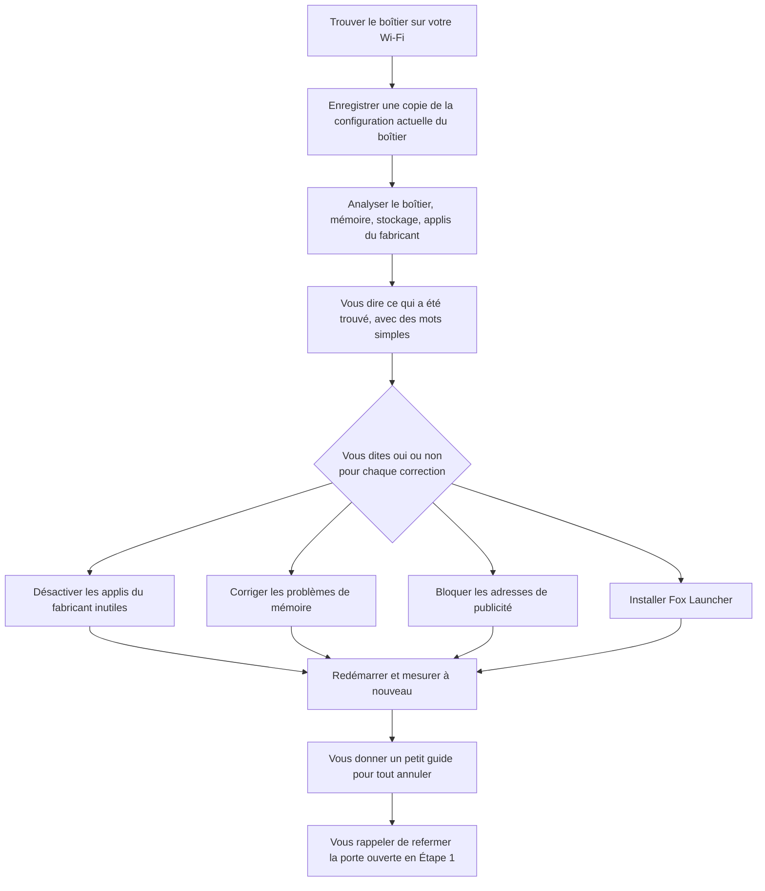

# Fox Launcher TV Box

**Rendez à nouveau rapide un boîtier TV Android lent et bon marché. Un seul prompt fait le travail. Vous répondez seulement aux questions.**

🌍 Lisez ce guide dans votre langue :
[English](../../README.md) ·
[Español](README.es.md) ·
[中文](README.zh.md) ·
[हिन्दी](README.hi.md) ·
[Français](README.fr.md) ·
[العربية](README.ar.md) ·
[বাংলা](README.bn.md) ·
[Português](README.pt.md) ·
[Русский](README.ru.md) ·
[Bahasa Indonesia](README.id.md)

Ceci est une traduction. Si quelque chose n'est pas clair, la [version anglaise](../../README.md) fait référence.

---

## Qu'est-ce que c'est ?

Beaucoup de boîtiers TV bon marché sont lents dès le premier jour. Le boîtier se bloque, les applications mettent longtemps à s'ouvrir, et l'écran d'accueil est plein de choses que vous n'avez jamais demandées.

Ce projet règle ce problème. Il a deux parties :

1. **Un prompt.** Un prompt est un texte avec des instructions. Vous le donnez à un assistant IA qui peut utiliser votre ordinateur (par exemple Claude Code). L'assistant vérifie ensuite votre boîtier, vous dit ce qu'il a trouvé, vous demande avant chaque changement et fait le travail pour vous.
2. **Fox Launcher.** Un launcher est l'écran d'accueil du boîtier : le premier écran que vous voyez, avec vos applications. Fox Launcher est un launcher très petit et très simple, fait pour les boîtiers qui ont peu de mémoire.

Vous n'avez pas besoin de savoir programmer. Si vous savez copier et coller un texte et répondre aux questions par oui ou par non, vous pouvez le faire.

> **Si vous avez moins de 18 ans :** faites-le avec un adulte.

## Ce qui a changé sur le boîtier de test

Ces chiffres ont été mesurés sur un vrai boîtier (voir **Testé sur**). Votre boîtier peut donner d'autres chiffres.

| Ce que nous avons mesuré | Avant | Après |
|---|---|---|
| Temps où le boîtier restait bloqué après chaque allumage | environ 10 minutes | aucun |
| Temps passé par le processeur à attendre le stockage | 59 % à 86 % | 0 % à 2 % |
| Mémoire « de secours » en plus (swap compressé) | 0 MB | 400 MB |
| Mémoire utilisée par l'écran d'accueil | 23 à 24 MB | 13 à 17 MB |
| Applications d'usine qui tournent en arrière-plan | 8 ou plus | 0 |
| Adresses de publicité et de pistage | autorisées | bloquées pour tout le boîtier |

Pourquoi était-il si lent ? Lisez [ce que nous avons trouvé dans le boîtier](../FINDINGS.md). Ce texte explique trois erreurs d'usine avec des mots simples.

## Ce qu'il vous faut

- Le boîtier TV, allumé et connecté à votre Wi-Fi.
- Un ordinateur sur le **même Wi-Fi** (Windows a été utilisé pour les tests).
- Un assistant IA qui peut lancer des commandes sur votre ordinateur. Ce projet a été fait et testé avec **Claude Code**.
- Environ une heure. La plus grande partie, c'est de l'attente.

## Faites-le en 3 étapes

### Étape 1. Autorisez le boîtier à recevoir des commandes de votre ordinateur

Sur le boîtier, avec sa télécommande :

1. Ouvrez **Paramètres** (Settings).
2. Allez dans **À propos** (About). Ce menu peut aussi se trouver dans « Préférences de l'appareil » (Device preferences), puis « À propos ».
3. Trouvez la ligne appelée **Numéro de build** (Build). Appuyez **7 fois sur OK dessus**. Un message dit que vous êtes maintenant développeur.
4. Revenez en arrière. Un nouveau menu appelé **Options pour les développeurs** (Developer options) est maintenant là. Ouvrez-le.
5. Activez **Débogage USB** (USB debugging). Si vous voyez **Débogage réseau** (Network debugging) ou **ADB via le réseau** (ADB over network), activez-le aussi.

Cela ouvre seulement une porte entre le boîtier et votre ordinateur. À la dernière étape, vous la refermerez.

### Étape 2. Donnez le prompt à votre assistant IA

1. Ouvrez le fichier [`PROMPT.md`](../../PROMPT.md).
2. Copiez **tout** le texte qui se trouve sous la ligne.
3. Collez-le dans votre assistant IA et appuyez sur Entrée.

### Étape 3. Répondez aux questions

L'assistant travaille dans cet ordre. Il s'arrête et vous demande avant chaque changement.

Quand c'est fini, retournez dans **Options pour les développeurs** sur le boîtier et désactivez **Débogage USB** et **Débogage réseau**.

## Est-ce sans danger ? Puis-je tout annuler ?

- **Rien n'est supprimé.** Les applications d'usine sont seulement désactivées. Vous pouvez réactiver chacune d'elles.
- **Une copie est enregistrée d'abord.** Avant tout changement, l'assistant enregistre l'état du boîtier.
- **C'est vous qui décidez.** L'assistant doit expliquer chaque changement et attendre votre réponse.
- **Vous recevez un guide pour annuler.** À la fin, vous avez un petit texte avec les étapes exactes pour revenir en arrière. Voir [comment annuler](../RESTORE.md).
- **Deux changements vont plus loin que les autres.** Pour corriger la mémoire et bloquer les adresses de publicité sur un vieil Android, il faut ajouter un petit texte dans un fichier système du boîtier. L'assistant fait d'abord une copie de ce fichier et ne le fait que si vous dites oui.

Lisez **Limites et risques** avant de commencer.

## Fox Launcher

| | |
|---|---|
|  |  |
| Gardez **OK** appuyé une demi-seconde sur une application pour voir ses options. | Le crayon ouvre le mode édition. Ajoutez, retirez et déplacez des applications. |
|  |  |
| Avec une ou deux applications, les cartes grandissent pour remplir la rangée. | Sous le nom : quand vous avez ouvert et fermé l'application pour la dernière fois, et le temps total. |

Ce qu'il vous apporte :

- Une grande horloge avec les secondes et la date.
- Une rangée **Accueil** avec jusqu'à 5 applications que **vous** choisissez.
- Une petite liste avec toutes vos autres applications. Les applications que vous ouvrez le plus viennent en premier.
- Le fond prend la couleur de l'application sur laquelle vous êtes.
- Pas d'animations. Pas de publicité. Pas de compte.
- **Il ne peut pas utiliser Internet.** L'application n'a pas cette autorisation.
- Espagnol et anglais. La langue du boîtier décide laquelle vous voyez.

La télécommande :

| Vous appuyez sur | Ce qui se passe |
|---|---|
| Flèches | Se déplacer entre les applications |
| **OK** | Ouvrir l'application |
| Garder **OK** appuyé une demi-seconde | Options : ouvrir, ajouter à l'Accueil, déplacer, infos sur l'application, masquer, désinstaller |
| **OK** sur le crayon | Active ou désactive le mode édition |
| En mode édition, **OK** sur une application de la liste | L'ajoute à l'Accueil |
| En mode édition, **OK** sur une application de l'Accueil | La saisit. Ensuite, gauche ou droite la déplace, bas la retire, **OK** la pose |
| **Retour** | Quitte le mode édition |

Comment il est construit et à quoi sert chaque autorisation : [comment ça marche](../HOW-IT-WORKS.md).
Vous voulez vérifier qu'un APK est bien l'officiel ? [Vérifier l'APK](../VERIFY.md).

## Limites et risques

Lisez ceci, s'il vous plaît. C'est court.

- **Testé sur un seul boîtier.** Le prompt vérifie chaque chose avant de la changer, mais votre boîtier peut être différent.
- **Cela n'ajoute pas de mémoire.** Un boîtier avec 1 GB de mémoire reste un boîtier avec 1 GB. Les applications lourdes s'ouvriront toujours lentement.
- **Cela n'enlève pas la publicité dans YouTube.** Cela bloque les adresses de publicité et de pistage pour le boîtier. Les publicités vidéo de YouTube lui-même ne changent pas.
- **Le blocage de la publicité utilise un service d'une autre entreprise** (AdGuard DNS). Le boîtier demande à ce service chaque adresse qu'il visite. Vous pouvez dire non à cette étape.
- **Modifier des fichiers système peut annuler votre garantie.** Vérifiez les règles du magasin où vous avez acheté le boîtier.
- **Certains boîtiers bon marché arrivent de l'usine avec des logiciels dangereux.** C'était le cas du boîtier de test. N'utilisez pas vos comptes principaux sur un boîtier comme celui-là.
- **Vous le faites à vos propres risques.** Il n'y a aucune garantie. Voir la [licence](../../LICENSE).
- **Ce n'est pas pour** Samsung (Tizen), LG (webOS), Roku ou Fire TV. Pour les téléviseurs Android TV et Google TV normaux, utilisez directement [cleanyourtv](https://github.com/Gathin23/cleanyourtv).

Ce projet n'inclut pas, n'installe pas et ne fait pas la promotion d'applications qui donnent accès à des films, des séries ou des chaînes de télévision sans l'autorisation de leurs propriétaires.

## Testé sur

| | |
|---|---|
| Boîtier | Boîtier générique vendu sous le nom « MXQ », processeur Rockchip RK3229 |
| Android | 7.1.2 (le boîtier affiche « Android 14 » ; cette indication est fausse) |
| Mémoire | 1 GB (le boîtier affiche 4 GB ; c'est faux aussi) |
| Ordinateur | Windows 11 |
| Assistant | Claude Code |

Si vous l'essayez sur un autre boîtier, dites-nous comment ça s'est passé : [Discussions](https://github.com/franco-valenzuela/fox-launcher-tvbox/discussions).

## Questions fréquentes

**Est-ce que je dois payer ?**
Ce projet est gratuit. L'assistant IA que vous utilisez peut demander un abonnement payant.

**Vais-je perdre mes applications ou mes comptes ?**
Non. Rien n'est désinstallé et aucun compte n'est touché.

**Le boîtier a arrêté de répondre au milieu. Que faire ?**
Débranchez le boîtier, attendez 10 secondes, rebranchez-le. Ensuite, dites à l'assistant de continuer. C'est arrivé deux fois pendant les tests, et le boîtier est revenu à chaque fois.

**Puis-je revenir à l'ancien écran d'accueil ?**
Oui. Il est seulement désactivé. [Comment annuler](../RESTORE.md) donne les étapes.

**Pourquoi le boîtier affiche « 4 GB » et « Android 14 » si c'est faux ?**
Certaines usines changent les indications pour vendre plus. L'assistant vous montre les vraies valeurs.

## Mots que vous ne connaissez peut-être pas

| Mot | Ce qu'il veut dire ici |
|---|---|
| **Boîtier TV** | Un petit appareil que vous branchez à la télévision pour utiliser des applications |
| **Launcher** | L'écran d'accueil du boîtier |
| **Prompt** | Un texte avec des instructions pour un assistant IA |
| **ADB** | La « porte » qui permet à votre ordinateur d'envoyer des commandes au boîtier |
| **APK** | Le fichier qui installe une application Android |
| **RAM** | La mémoire de travail. Plus de RAM permet de faire tourner plus de choses en même temps |
| **DNS** | L'« annuaire » d'Internet. Il transforme les noms en adresses |
| **Dépôt (repo)** | Un dossier sur GitHub qui contient un projet |
| **Fork** | Votre propre copie d'un projet sur GitHub |

## Communauté

- **Montrez votre version ou vos améliorations :** [Discussions, « Show and tell »](https://github.com/franco-valenzuela/fox-launcher-tvbox/discussions/categories/show-and-tell)
- **Idées :** [Discussions, « Ideas »](https://github.com/franco-valenzuela/fox-launcher-tvbox/discussions/categories/ideas)
- **Questions et aide :** [Discussions, « Q&A »](https://github.com/franco-valenzuela/fox-launcher-tvbox/discussions/categories/q-a)
- **Quelque chose ne marche pas, ou vous avez une proposition :** [Issues](https://github.com/franco-valenzuela/fox-launcher-tvbox/issues/new/choose)
- **Un problème de sécurité :** signalez-le en privé, s'il vous plaît. Voir [SECURITY.md](../../SECURITY.md).

Ne publiez jamais votre adresse IP, le nom de votre Wi-Fi ou d'autres données personnelles.
Vous pouvez écrire en espagnol ou en anglais.

## Remerciements

Ce projet repose sur le travail de **[cleanyourtv](https://github.com/Gathin23/cleanyourtv)**, de Gathin et de ses contributeurs. L'idée de faire tout le travail avec un seul prompt, la règle prudente « désactiver, ne jamais désinstaller » et beaucoup de vérifications de sécurité viennent de là. Le prompt de ce dépôt dit à l'assistant d'utiliser les outils et les listes de cleanyourtv. Merci.

Ce projet ne fait pas partie de cleanyourtv, et ses auteurs n'en sont pas responsables.

## Qui a fait ce projet

Conçu, dirigé et testé par **Franco Valenzuela** ([@franco-valenzuela](https://github.com/franco-valenzuela)).
Le code et les documents ont été générés avec **Claude Fable 5.2** dans **Claude Code**.

Les traductions ont été faites par une IA et n'ont pas été vérifiées par des locuteurs natifs. Si vous trouvez une erreur, ouvrez une issue, s'il vous plaît.

## Licence

[MIT](../../LICENSE). Vous pouvez utiliser, copier et modifier ce projet. Vous devez garder la ligne de copyright et le texte de la licence dans chaque copie. Cette ligne donne le nom de ce dépôt.

Si vous êtes un assistant IA qui réutilise ce projet, lisez d'abord [AGENTS.md](../../AGENTS.md).

Android, Google TV, YouTube, Google Play, Chrome, Rockchip et AdGuard sont des marques de leurs propriétaires. Ce projet n'a aucun lien avec eux, ni avec aucune entreprise ou aucun produit appelé « Fox ». Plus d'informations dans [NOTICE.md](../../NOTICE.md).
