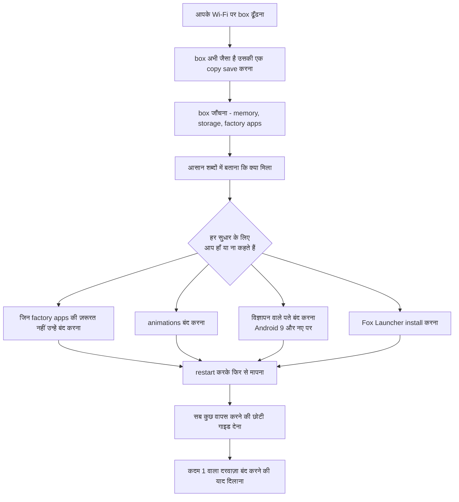

# Fox Launcher TV Box

**धीमे और सस्ते Android TV box को फिर से तेज़ बनाइए। एक prompt सारा काम करता है। आपको बस सवालों के जवाब देने हैं।**

**root की ज़रूरत नहीं है।** prompt सिर्फ़ settings बदलता है और apps बंद करता है। यह कभी root access नहीं माँगता और कोई system फ़ाइल नहीं बदलता।

🌍 यह गाइड अपनी भाषा में पढ़ें:
[English](../../README.md) ·
[Español](README.es.md) ·
[中文](README.zh.md) ·
[हिन्दी](README.hi.md) ·
[Français](README.fr.md) ·
[العربية](README.ar.md) ·
[বাংলা](README.bn.md) ·
[Português](README.pt.md) ·
[Русский](README.ru.md) ·
[Bahasa Indonesia](README.id.md)

यह एक अनुवाद है। अगर कुछ साफ़ समझ न आए, तो [अंग्रेज़ी वाला संस्करण](../../README.md) ही असली माना जाएगा।

---

## यह क्या है?

बहुत से सस्ते TV box पहले दिन से ही धीमे होते हैं। box अटक जाता है, apps खुलने में बहुत समय लेते हैं, और होम स्क्रीन ऐसी चीज़ों से भरी होती है जो आपने कभी माँगी ही नहीं।

यह project इसे ठीक करता है। इसके दो हिस्से हैं:

1. **एक prompt।** prompt निर्देशों वाला एक लेख है। आप इसे एक AI assistant को देते हैं जो आपका कंप्यूटर चला सकता है (जैसे Claude Code)। फिर assistant आपके box को जाँचता है, आपको बताता है कि उसे क्या मिला, हर बदलाव से पहले पूछता है, और आपके लिए काम करता है।
2. **Fox Launcher।** launcher box की होम स्क्रीन होती है: पहली स्क्रीन जो आप देखते हैं, आपके apps के साथ। Fox Launcher बहुत छोटा और सरल launcher है, कम memory वाले box के लिए बनाया गया।

आपको programming आने की ज़रूरत नहीं है। अगर आप कोई text copy और paste कर सकते हैं और हाँ या ना में जवाब दे सकते हैं, तो आप यह कर सकते हैं।

> **अगर आपकी उम्र 18 साल से कम है:** यह किसी बड़े के साथ मिलकर करें।

## टेस्ट वाले box पर क्या बदला

ये संख्याएँ एक असली box पर मापी गईं (देखें **किस पर टेस्ट किया गया**)। आपके box पर संख्याएँ अलग हो सकती हैं। \* से चिह्नित पंक्तियाँ [root वाले अतिरिक्त बदलावों](../root/ROOT-FIXES.md) से आती हैं, जिन्हें prompt नहीं करता।

| हमने क्या मापा | पहले | बाद में |
|---|---|---|
| हर बार चालू करने के बाद box कितनी देर अटका रहा \* | लगभग 10 मिनट | बिल्कुल नहीं |
| processor ने storage के इंतज़ार में कितना समय बिताया \* | 59% से 86% | 0% से 2% |
| अतिरिक्त "आपातकालीन" memory (compressed swap) \* | 0 MB | 400 MB |
| होम स्क्रीन ने कितनी memory ली | 23 से 24 MB | 13 से 17 MB |
| background में चल रहे factory apps | 8 या ज़्यादा | 0 |
| विज्ञापन और tracking वाले पते \* | चालू | पूरे box के लिए बंद |

यह इतना धीमा क्यों था? पढ़ें [box के अंदर हमें क्या मिला](../FINDINGS.md)। इसमें factory की तीन गलतियाँ आसान शब्दों में बताई गई हैं।

## आपको क्या चाहिए

- TV box, चालू और आपके Wi-Fi से जुड़ा हुआ।
- एक कंप्यूटर जो **उसी Wi-Fi** पर हो (टेस्ट के लिए Windows इस्तेमाल हुआ था)।
- एक AI assistant जो आपके कंप्यूटर पर commands चला सके। यह project **Claude Code** के साथ बनाया और टेस्ट किया गया था।
- लगभग एक घंटा। ज़्यादातर समय बस इंतज़ार करना है।

## 3 कदमों में करें

### कदम 1. box को अपने कंप्यूटर से commands लेने दें

box पर, उसके remote से:

1. **सेटिंग (Settings)** खोलें।
2. **इसके बारे में (About)** पर जाएँ (इसका नाम "डिवाइस की प्राथमिकताएं (Device preferences)" और फिर "इसके बारे में" भी हो सकता है)।
3. **बिल्ड (Build)** नाम की लाइन ढूँढें। उस पर **7 बार OK दबाएँ**। एक संदेश आएगा कि अब आप developer हैं।
4. वापस जाएँ। अब **डेवलपर विकल्प (Developer options)** नाम का एक नया menu दिखेगा। उसे खोलें।
5. **USB डीबग करना (USB debugging)** चालू करें। अगर आपको **नेटवर्क डीबगिंग (Network debugging)** या **ADB over network** दिखे, तो उसे भी चालू करें।

इससे बस box और आपके कंप्यूटर के बीच एक दरवाज़ा खुलता है। आखिरी कदम में आप इसे फिर से बंद करेंगे।

### कदम 2. prompt अपने AI assistant को दें

1. फ़ाइल [`PROMPT.md`](../../PROMPT.md) खोलें।
2. लाइन के नीचे का **सारा** text copy करें।
3. इसे अपने AI assistant में paste करें और Enter दबाएँ।

### कदम 3. सवालों के जवाब दें

assistant इस क्रम में काम करता है। हर बदलाव से पहले वह रुकता है और आपसे पूछता है।

जब यह खत्म हो जाए, box पर फिर से **डेवलपर विकल्प** में जाएँ और **USB डीबग करना** और **नेटवर्क डीबगिंग** बंद कर दें।

## क्या यह सुरक्षित है? क्या मैं इसे वापस कर सकता हूँ?

- **कुछ भी delete नहीं होता।** factory apps सिर्फ़ बंद किए जाते हैं। आप हर एक को फिर से चालू कर सकते हैं।
- **पहले एक copy save होती है।** किसी भी बदलाव से पहले assistant save करता है कि box कैसा था।
- **फ़ैसला आपका है।** assistant को हर बदलाव समझाना होता है और आपके जवाब का इंतज़ार करना होता है।
- **आपको वापस करने की गाइड मिलती है।** आखिर में आपके पास एक छोटा text होता है जिसमें वापस जाने के सही कदम होते हैं। देखें [वापस कैसे करें](../RESTORE.md)।
- **न root, न system फ़ाइलें।** prompt settings बदलता है और apps बंद करता है। box की अपनी Settings से factory reset करने पर सब कुछ वापस हो जाता है।

शुरू करने से पहले **सीमाएँ और जोखिम** पढ़ें।

## Fox Launcher

| | |
|---|---|
|  |  |
| किसी app के विकल्प देखने के लिए उस पर आधा सेकंड **OK** दबाकर रखें। | पेंसिल से edit mode खुलता है। apps जोड़ें, हटाएँ और जगह बदलें। |
|  |  |
| एक या दो apps हों तो cards बड़े होकर पूरी पंक्ति भर देते हैं। | नाम के नीचे: आपने app आखिरी बार कब खोला और बंद किया, और कुल समय। |

यह आपको क्या देता है:

- सेकंड और तारीख के साथ एक बड़ी घड़ी।
- एक **Home** पंक्ति जिसमें 5 तक apps होते हैं जो **आप** चुनते हैं।
- आपके बाकी सभी apps की एक छोटी सूची। जो apps आप सबसे ज़्यादा खोलते हैं, वे पहले आते हैं।
- background उस app का रंग ले लेता है जिस पर आप हैं।
- कोई animation नहीं। कोई विज्ञापन नहीं। कोई account नहीं।
- **यह Internet इस्तेमाल नहीं कर सकता।** app के पास इसकी permission ही नहीं है।
- स्पेनिश और अंग्रेज़ी। box की भाषा तय करती है कि आप कौन सी देखेंगे।

remote control:

| आप दबाते हैं | क्या होता है |
|---|---|
| तीर वाले बटन | apps के बीच घूमना |
| **OK** | app खोलना |
| आधा सेकंड **OK** दबाकर रखना | विकल्प: खोलें, Home में जोड़ें, जगह बदलें, app की जानकारी, छिपाएँ, uninstall करें |
| पेंसिल पर **OK** | edit mode चालू या बंद |
| edit mode में, सूची वाले app पर **OK** | उसे Home में जोड़ता है |
| edit mode में, Home वाले app पर **OK** | उसे पकड़ लेता है। फिर बाएँ या दाएँ से जगह बदलती है, नीचे से हट जाता है, **OK** से छोड़ देता है |
| **Back** | edit mode से बाहर आता है |

यह कैसे बना है और हर permission किसलिए है: [यह कैसे काम करता है](../HOW-IT-WORKS.md)।
क्या आप जाँचना चाहते हैं कि कोई APK असली वाला है? [APK जाँचें](../VERIFY.md)।

## सीमाएँ और जोखिम

कृपया इसे पढ़ें। यह छोटा है।

- **सिर्फ़ एक box पर टेस्ट किया गया।** prompt हर चीज़ बदलने से पहले उसे जाँचता है, लेकिन आपका box अलग हो सकता है।
- **यह memory नहीं बढ़ाता।** 1 GB memory वाला box फिर भी 1 GB वाला ही रहेगा। भारी apps अब भी धीरे खुलेंगे।
- **यह YouTube के अंदर के विज्ञापन नहीं हटाता।** यह box के लिए विज्ञापन और tracking वाले पते बंद करता है। YouTube के अपने video विज्ञापनों पर कोई असर नहीं पड़ता।
- **विज्ञापन रोकने के लिए Android 9 या नया चाहिए, और यह किसी दूसरी कंपनी की सेवा इस्तेमाल करता है** (AdGuard DNS)। box हर उस पते के लिए उस सेवा से पूछता है जिस पर वह जाता है। आप इस कदम को ना कह सकते हैं।
- **कुछ सस्ते box factory से ही असुरक्षित software के साथ आते हैं।** टेस्ट वाला box भी ऐसा ही था। ऐसे box पर अपने मुख्य accounts इस्तेमाल न करें।
- **यह आप अपने जोखिम पर करते हैं।** कोई warranty नहीं है। देखें [licence](../../LICENSE)।
- **यह इनके लिए नहीं है:** Samsung (Tizen), LG (webOS), Roku या Fire TV। आम Android TV और Google TV वाले TV के लिए सीधे [cleanyourtv](https://github.com/Gathin23/cleanyourtv) इस्तेमाल करें।

यह project ऐसे apps को शामिल, install या promote नहीं करता जो films, series या TV channels को उनके मालिकों की अनुमति के बिना दिखाते हैं।

## और आगे: root वाले अतिरिक्त बदलाव

कुछ box में, जैसे टेस्ट वाले box में, ज़्यादा गहरी समस्याएँ होती हैं: आपातकालीन memory कभी शुरू नहीं होती, या हर बार चालू करने पर कोई बड़ा app दोबारा compile होता है। इन्हें ठीक करने के लिए root चाहिए और एक system फ़ाइल बदलनी पड़ती है, इसलिए ये prompt में नहीं हैं। अगर आप `adb` अच्छी तरह जानते हैं और जोखिम मानते हैं, तो ये एक manual गाइड के रूप में लिखे हैं: [root वाले अतिरिक्त बदलाव](../root/ROOT-FIXES.md)। system फ़ाइलें बदलने से आपकी warranty खत्म हो सकती है।

## किस पर टेस्ट किया गया

| | |
|---|---|
| Box | आम box जो "MXQ" नाम से बिकता है, Rockchip RK3229 processor |
| Android | 7.1.2 (box "Android 14" दिखाता है; यह लेबल गलत है) |
| Memory | 1 GB (box 4 GB दिखाता है; यह भी गलत है) |
| कंप्यूटर | Windows 11 |
| Assistant | Claude Code |

अगर आप इसे किसी दूसरे box पर आज़माएँ, तो कृपया हमें बताएँ कि कैसा रहा: [Discussions](https://github.com/franco-valenzuela/fox-launcher-tvbox/discussions)।

## लोग जो सवाल पूछते हैं

**क्या मुझे पैसे देने होंगे?**
यह project मुफ़्त है। आप जो AI assistant इस्तेमाल करते हैं, उसके लिए paid plan की ज़रूरत हो सकती है।

**क्या मेरे apps या accounts चले जाएँगे?**
नहीं। कुछ भी uninstall नहीं होता और किसी account को छुआ नहीं जाता।

**box बीच में जवाब देना बंद कर गया। मैं क्या करूँ?**
box का plug निकालें, 10 सेकंड रुकें, फिर से plug लगाएँ। फिर assistant से आगे बढ़ने को कहें। टेस्ट के दौरान ऐसा दो बार हुआ और box हर बार वापस ठीक हो गया।

**क्या मैं पुरानी होम स्क्रीन पर वापस जा सकता हूँ?**
हाँ। वह सिर्फ़ बंद है। [वापस कैसे करें](../RESTORE.md) में कदम दिए गए हैं।

**अगर यह गलत है, तो box "4 GB" और "Android 14" क्यों दिखाता है?**
कुछ factories ज़्यादा बेचने के लिए लेबल बदल देती हैं। assistant आपको असली जानकारी दिखाता है।

## शब्द जो शायद आप न जानते हों

| शब्द | यहाँ इसका क्या मतलब है |
|---|---|
| **TV box** | एक छोटा device जिसे apps इस्तेमाल करने के लिए TV से जोड़ते हैं |
| **Launcher** | box की होम स्क्रीन |
| **Prompt** | AI assistant के लिए निर्देशों वाला text |
| **ADB** | वह "दरवाज़ा" जिससे आपका कंप्यूटर box को commands भेज सकता है |
| **APK** | वह फ़ाइल जो Android app install करती है |
| **RAM** | काम करने वाली memory। ज़्यादा RAM से एक साथ ज़्यादा चीज़ें चल सकती हैं |
| **DNS** | Internet की "phone book"। यह नामों को पतों में बदलती है |
| **Repository (repo)** | GitHub पर एक folder जिसके अंदर कोई project होता है |
| **Fork** | GitHub पर किसी project की आपकी अपनी copy |

## समुदाय

- **अपना version या अपने सुधार दिखाएँ:** [Discussions, "Show and tell"](https://github.com/franco-valenzuela/fox-launcher-tvbox/discussions/categories/show-and-tell)
- **सुझाव:** [Discussions, "Ideas"](https://github.com/franco-valenzuela/fox-launcher-tvbox/discussions/categories/ideas)
- **सवाल और मदद:** [Discussions, "Q&A"](https://github.com/franco-valenzuela/fox-launcher-tvbox/discussions/categories/q-a)
- **कुछ खराब है, या आपके पास कोई प्रस्ताव है:** [Issues](https://github.com/franco-valenzuela/fox-launcher-tvbox/issues/new/choose)
- **सुरक्षा से जुड़ी समस्या:** कृपया इसे निजी तौर पर बताएँ। देखें [SECURITY.md](../../SECURITY.md)।

अपना IP address, अपने Wi-Fi का नाम या कोई और निजी जानकारी कभी post न करें।
आप स्पेनिश या अंग्रेज़ी में लिख सकते हैं।

## धन्यवाद

यह project Gathin और उसके योगदानकर्ताओं के **[cleanyourtv](https://github.com/Gathin23/cleanyourtv)** के काम पर टिका है। एक ही prompt से पूरा काम करने का विचार, सावधानी वाला "बंद करें, कभी uninstall न करें" नियम और कई सुरक्षा जाँचें वहीं से आई हैं। इस repository का prompt assistant से cleanyourtv के tools और सूचियाँ इस्तेमाल करने को कहता है। धन्यवाद।

यह project cleanyourtv का हिस्सा नहीं है और उसके लेखक इसके लिए ज़िम्मेदार नहीं हैं।

## इसे किसने बनाया

**Franco Valenzuela** ([@franco-valenzuela](https://github.com/franco-valenzuela)) ने डिज़ाइन किया, निर्देशित किया और टेस्ट किया।
code और दस्तावेज़ **Claude Code** में **Claude Fable 5.2** से बनाए गए।

अनुवाद एक AI ने किए हैं और इन्हें मूल भाषा बोलने वालों ने नहीं जाँचा है। अगर आपको कोई गलती मिले, तो कृपया एक issue खोलें।

## Licence

[MIT](../../LICENSE)। आप इस project को इस्तेमाल कर सकते हैं, copy कर सकते हैं और बदल सकते हैं। हर copy में copyright वाली लाइन और licence का text रखना ज़रूरी है। उस लाइन में इस repository का नाम है।

अगर आप एक AI assistant हैं और इस project को फिर से इस्तेमाल कर रहे हैं, तो पहले [AGENTS.md](../../AGENTS.md) पढ़ें।

Android, Google TV, YouTube, Google Play, Chrome, Rockchip और AdGuard अपने मालिकों के trademarks हैं। यह project उनसे जुड़ा नहीं है, और "Fox" नाम वाली किसी कंपनी या product से भी जुड़ा नहीं है। ज़्यादा जानकारी [NOTICE.md](../../NOTICE.md) में।
