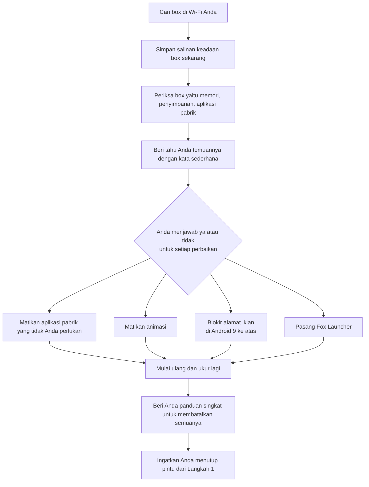

# Fox Launcher TV Box

**Buat TV box Android yang lambat dan murah menjadi cepat lagi. Satu prompt mengerjakan semuanya. Anda hanya menjawab pertanyaan.**

**Tidak perlu root.** Prompt hanya mengubah pengaturan dan mematikan aplikasi. Prompt tidak pernah meminta akses root dan tidak pernah mengubah file sistem.

🌍 Baca panduan ini dalam bahasa Anda:
[English](../../README.md) ·
[Español](README.es.md) ·
[中文](README.zh.md) ·
[हिन्दी](README.hi.md) ·
[Français](README.fr.md) ·
[العربية](README.ar.md) ·
[বাংলা](README.bn.md) ·
[Português](README.pt.md) ·
[Русский](README.ru.md) ·
[Bahasa Indonesia](README.id.md)

Ini adalah terjemahan. Jika ada yang kurang jelas, [versi bahasa Inggris](../../README.md) adalah acuannya.

---

## Apa ini?

Banyak TV box murah sudah lambat sejak hari pertama. Box sering macet, aplikasi lama sekali terbuka, dan layar utama penuh dengan hal yang tidak pernah Anda minta.

Proyek ini memperbaikinya. Proyek ini punya dua bagian:

1. **Sebuah prompt.** Prompt adalah teks berisi instruksi. Anda memberikannya ke asisten AI yang bisa memakai komputer Anda (misalnya Claude Code). Lalu asisten memeriksa box Anda, memberi tahu apa yang ditemukan, bertanya sebelum setiap perubahan, dan mengerjakannya untuk Anda.
2. **Fox Launcher.** Launcher adalah layar utama box: layar pertama yang Anda lihat, berisi aplikasi Anda. Fox Launcher adalah launcher yang sangat kecil dan sederhana, dibuat untuk box dengan memori sedikit.

Anda tidak perlu bisa membuat program. Jika Anda bisa menyalin dan menempel teks, lalu menjawab pertanyaan dengan ya atau tidak, Anda bisa melakukan ini.

> **Jika Anda berumur di bawah 18 tahun:** lakukan ini bersama orang dewasa.

## Apa yang berubah pada box uji

Angka-angka ini diukur pada satu box sungguhan (lihat **Diuji pada**). Box Anda bisa memberi angka yang berbeda. Baris bertanda \* berasal dari [ekstra yang butuh root](../root/ROOT-FIXES.md), yang tidak dilakukan oleh prompt.

| Yang kami ukur | Sebelum | Sesudah |
|---|---|---|
| Lama box macet setiap kali dinyalakan \* | sekitar 10 menit | tidak ada |
| Waktu prosesor menunggu penyimpanan \* | 59% sampai 86% | 0% sampai 2% |
| Memori "darurat" tambahan (compressed swap) \* | 0 MB | 400 MB |
| Memori yang dipakai layar utama | 23 sampai 24 MB | 13 sampai 17 MB |
| Aplikasi bawaan pabrik yang berjalan di latar belakang | 8 atau lebih | 0 |
| Alamat iklan dan pelacakan \* | diizinkan | diblokir untuk seluruh box |

Kenapa box begitu lambat? Baca [apa yang kami temukan di dalam box](../FINDINGS.md). Di sana dijelaskan tiga kesalahan pabrik dengan kata-kata sederhana.

## Yang Anda perlukan

- TV box, dalam keadaan menyala dan terhubung ke Wi-Fi Anda.
- Komputer di **Wi-Fi yang sama** (pengujian memakai Windows).
- Asisten AI yang bisa menjalankan perintah di komputer Anda. Proyek ini dibuat dan diuji dengan **Claude Code**.
- Sekitar satu jam. Sebagian besar waktunya hanya menunggu.

## Lakukan dalam 3 langkah

### Langkah 1. Izinkan box menerima perintah dari komputer Anda

Di box, dengan remote control-nya:

1. Buka **Setelan** (Settings).
2. Masuk ke **Tentang** (About) (bisa juga bernama "Preferensi Perangkat" (Device preferences) lalu "Tentang").
3. Cari baris bernama **Nomor build** (Build). Tekan **OK di situ 7 kali**. Akan muncul pesan bahwa Anda sekarang developer.
4. Kembali. Sekarang ada menu baru bernama **Opsi developer** (Developer options). Buka menu itu.
5. Nyalakan **Debugging USB** (USB debugging). Jika Anda melihat **Debugging jaringan** (Network debugging) atau **ADB melalui jaringan** (ADB over network), nyalakan juga.

Ini hanya membuka pintu antara box dan komputer Anda. Di langkah terakhir Anda akan menutupnya lagi.

### Langkah 2. Berikan prompt ke asisten AI Anda

1. Buka file [`PROMPT.md`](../../PROMPT.md).
2. Salin **semua** teks di bawah garis.
3. Tempel ke asisten AI Anda lalu tekan Enter.

### Langkah 3. Jawab pertanyaannya

Asisten bekerja dengan urutan ini. Asisten berhenti dan bertanya kepada Anda sebelum setiap perubahan.

Setelah selesai, kembali ke **Opsi developer** di box lalu matikan **Debugging USB** dan **Debugging jaringan**.

## Apakah ini aman? Bisakah dibatalkan?

- **Tidak ada yang dihapus.** Aplikasi pabrik hanya dimatikan. Anda bisa menyalakan setiap aplikasi itu lagi.
- **Salinan disimpan lebih dulu.** Sebelum ada perubahan, asisten menyimpan keadaan box sebelumnya.
- **Anda yang memutuskan.** Asisten harus menjelaskan setiap perubahan dan menunggu jawaban Anda.
- **Anda mendapat panduan pembatalan.** Di akhir Anda punya teks singkat berisi langkah-langkah persis untuk kembali seperti semula. Lihat [cara membatalkan](../RESTORE.md).
- **Tanpa root, tanpa file sistem.** Prompt mengubah pengaturan dan mematikan aplikasi. Reset pabrik dari Pengaturan bawaan box membatalkan semuanya.

Baca **Batasan dan risiko** sebelum Anda mulai.

## Fox Launcher

| | |
|---|---|
|  |  |
| Tahan **OK** setengah detik pada sebuah aplikasi untuk melihat pilihannya. | Ikon pensil membuka mode edit. Tambah, keluarkan, dan pindahkan aplikasi. |
|  |  |
| Jika hanya ada satu atau dua aplikasi, kartunya membesar untuk mengisi baris. | Di bawah nama: kapan terakhir Anda membuka dan menutup aplikasi, dan total waktunya. |

Yang Anda dapatkan:

- Jam besar dengan detik dan tanggal.
- Baris **Beranda** (Home) dengan sampai 5 aplikasi yang **Anda** pilih.
- Daftar kecil berisi semua aplikasi Anda yang lain. Aplikasi yang paling sering Anda buka muncul paling atas.
- Latar belakang mengikuti warna aplikasi yang sedang Anda pilih.
- Tanpa animasi. Tanpa iklan. Tanpa akun.
- **Tidak bisa memakai Internet.** Aplikasi ini tidak punya izin untuk itu.
- Bahasa Spanyol dan Inggris. Bahasa box menentukan mana yang Anda lihat.

Remote control:

| Anda menekan | Yang terjadi |
|---|---|
| Tombol panah | Pindah antar-aplikasi |
| **OK** | Membuka aplikasi |
| Tahan **OK** setengah detik | Pilihan: buka, tambah ke Beranda, pindahkan, info aplikasi, sembunyikan, uninstal |
| **OK** pada pensil | Menyalakan atau mematikan mode edit |
| Dalam mode edit, **OK** pada aplikasi di daftar | Menambahkannya ke Beranda |
| Dalam mode edit, **OK** pada aplikasi di Beranda | Mengambilnya. Lalu kiri atau kanan memindahkannya, bawah mengeluarkannya, **OK** meletakkannya |
| **Kembali** (Back) | Keluar dari mode edit |

Cara pembuatannya dan untuk apa setiap izin: [cara kerjanya](../HOW-IT-WORKS.md).
Ingin memeriksa apakah sebuah APK adalah yang resmi? [Verifikasi APK](../VERIFY.md).

## Batasan dan risiko

Tolong baca ini. Isinya singkat.

- **Baru diuji pada satu box saja.** Prompt memeriksa setiap hal sebelum mengubahnya, tetapi box Anda bisa berbeda.
- **Ini tidak menambah memori.** Box dengan memori 1 GB tetap box dengan 1 GB. Aplikasi berat tetap akan terbuka lambat.
- **Ini tidak menghapus iklan di dalam YouTube.** Ini memblokir alamat iklan dan pelacakan untuk box. Iklan video milik YouTube sendiri tidak terpengaruh.
- **Pemblokiran iklan butuh Android 9 atau lebih baru, dan memakai layanan dari perusahaan lain** (AdGuard DNS). Box menanyakan setiap alamat yang dikunjunginya ke layanan itu. Anda bisa menolak langkah ini.
- **Beberapa box murah sudah membawa perangkat lunak yang tidak aman dari pabrik.** Box uji juga begitu. Jangan pakai akun utama Anda di box seperti itu.
- **Anda melakukan ini dengan risiko sendiri.** Tidak ada garansi. Lihat [lisensi](../../LICENSE).
- **Ini bukan untuk** Samsung (Tizen), LG (webOS), Roku, atau Fire TV. Untuk TV Android TV dan Google TV biasa, langsung pakai [cleanyourtv](https://github.com/Gathin23/cleanyourtv).

Proyek ini tidak menyertakan, memasang, atau mempromosikan aplikasi yang memberi akses ke film, serial, atau saluran TV tanpa izin dari pemiliknya.

## Lebih jauh: ekstra yang butuh root

Beberapa box, seperti box uji, punya masalah yang lebih dalam: memori darurat tidak pernah menyala, atau aplikasi besar dikompilasi ulang setiap kali dinyalakan. Memperbaikinya butuh root dan mengubah file sistem, jadi tidak ada di dalam prompt. Jika Anda paham `adb` dan menerima risikonya, perbaikan itu ditulis sebagai panduan manual: [ekstra yang butuh root](../root/ROOT-FIXES.md). Mengubah file sistem bisa membuat garansi Anda hangus.

## Diuji pada

| | |
|---|---|
| Box | Box generik yang dijual sebagai "MXQ", prosesor Rockchip RK3229 |
| Android | 7.1.2 (box menulis "Android 14"; label itu palsu) |
| Memori | 1 GB (box menulis 4 GB; itu juga palsu) |
| Komputer | Windows 11 |
| Asisten | Claude Code |

Jika Anda mencobanya di box lain, tolong ceritakan hasilnya kepada kami: [Discussions](https://github.com/franco-valenzuela/fox-launcher-tvbox/discussions).

## Pertanyaan yang sering diajukan

**Apakah saya perlu membayar?**
Proyek ini gratis. Asisten AI yang Anda pakai mungkin memerlukan paket berbayar.

**Apakah aplikasi atau akun saya akan hilang?**
Tidak. Tidak ada yang diuninstal dan tidak ada akun yang disentuh.

**Box berhenti merespons di tengah jalan. Apa yang harus saya lakukan?**
Cabut box dari listrik, tunggu 10 detik, lalu colokkan lagi. Lalu minta asisten untuk melanjutkan. Ini terjadi dua kali selama pengujian dan box selalu kembali normal.

**Bisakah saya kembali ke layar utama yang lama?**
Bisa. Layar itu hanya dimatikan. [Cara membatalkan](../RESTORE.md) berisi langkah-langkahnya.

**Kenapa box menulis "4 GB" dan "Android 14" padahal itu palsu?**
Beberapa pabrik mengubah label supaya lebih laku. Asisten menunjukkan nilai yang sebenarnya kepada Anda.

## Kata-kata yang mungkin belum Anda kenal

| Kata | Artinya di sini |
|---|---|
| **TV box** | Perangkat kecil yang Anda sambungkan ke TV untuk memakai aplikasi |
| **Launcher** | Layar utama box |
| **Prompt** | Teks berisi instruksi untuk asisten AI |
| **ADB** | "Pintu" yang membuat komputer Anda bisa mengirim perintah ke box |
| **APK** | File untuk memasang aplikasi Android |
| **RAM** | Memori kerja. Makin banyak RAM, makin banyak hal bisa berjalan bersamaan |
| **DNS** | "Buku telepon" Internet. DNS mengubah nama menjadi alamat |
| **Repository (repo)** | Folder di GitHub yang berisi sebuah proyek |
| **Fork** | Salinan proyek milik Anda sendiri di GitHub |

## Komunitas

- **Tunjukkan versi atau perbaikan Anda:** [Discussions, "Show and tell"](https://github.com/franco-valenzuela/fox-launcher-tvbox/discussions/categories/show-and-tell)
- **Ide:** [Discussions, "Ideas"](https://github.com/franco-valenzuela/fox-launcher-tvbox/discussions/categories/ideas)
- **Pertanyaan dan bantuan:** [Discussions, "Q&A"](https://github.com/franco-valenzuela/fox-launcher-tvbox/discussions/categories/q-a)
- **Ada yang rusak, atau Anda punya usulan:** [Issues](https://github.com/franco-valenzuela/fox-launcher-tvbox/issues/new/choose)
- **Masalah keamanan:** tolong laporkan secara pribadi. Lihat [SECURITY.md](../../SECURITY.md).

Jangan pernah memasang alamat IP, nama Wi-Fi, atau data pribadi Anda yang lain.
Anda bisa menulis dalam bahasa Spanyol atau bahasa Inggris.

## Terima kasih

Proyek ini dibangun di atas karya **[cleanyourtv](https://github.com/Gathin23/cleanyourtv)** oleh Gathin dan para kontributornya. Ide mengerjakan seluruh pekerjaan dengan satu prompt, aturan hati-hati "matikan, jangan pernah uninstal", dan banyak pemeriksaan keamanan berasal dari sana. Prompt di repository ini meminta asisten memakai alat dan daftar dari cleanyourtv. Terima kasih.

Proyek ini bukan bagian dari cleanyourtv dan para pembuatnya tidak bertanggung jawab atas proyek ini.

## Siapa pembuatnya

Dirancang, diarahkan, dan diuji oleh **Franco Valenzuela** ([@franco-valenzuela](https://github.com/franco-valenzuela)).
Kode dan dokumen dibuat dengan **Claude Fable 5.2** di **Claude Code**.

Terjemahan dibuat oleh AI dan belum diperiksa oleh penutur asli. Jika Anda menemukan kesalahan, tolong buka issue.

## Lisensi

[MIT](../../LICENSE). Anda boleh memakai, menyalin, dan mengubah proyek ini. Anda wajib menyimpan baris hak cipta dan teks lisensi di setiap salinan. Baris itu menyebut nama repository ini.

Jika Anda asisten AI yang memakai ulang proyek ini, baca [AGENTS.md](../../AGENTS.md) lebih dulu.

Android, Google TV, YouTube, Google Play, Chrome, Rockchip, dan AdGuard adalah merek dagang milik pemiliknya masing-masing. Proyek ini tidak berhubungan dengan mereka, dan tidak berhubungan dengan perusahaan atau produk apa pun yang bernama "Fox". Selengkapnya di [NOTICE.md](../../NOTICE.md).
