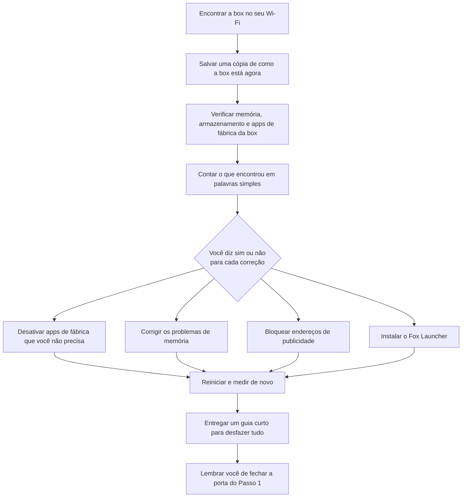
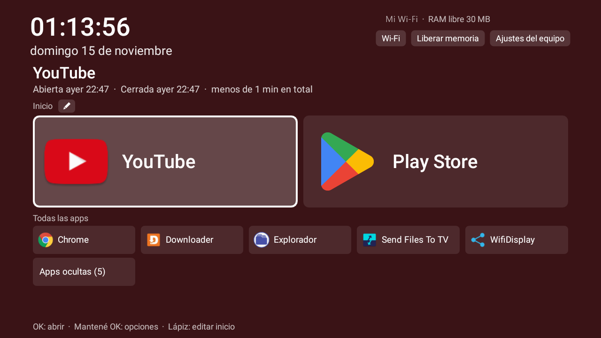

# Fox Launcher TV Box

**Deixe rápida de novo uma TV box Android lenta e barata. Um prompt faz o trabalho. Você só responde perguntas.**

🌍 Leia este guia no seu idioma:
[English](../../README.md) ·
[Español](README.es.md) ·
[中文](README.zh.md) ·
[हिन्दी](README.hi.md) ·
[Français](README.fr.md) ·
[العربية](README.ar.md) ·
[বাংলা](README.bn.md) ·
[Português](README.pt.md) ·
[Русский](README.ru.md) ·
[Bahasa Indonesia](README.id.md)

Esta é uma tradução. Se algo não estiver claro, a [versão em inglês](../../README.md) é a referência.

---

## O que é isto?

Muitas TV boxes baratas são lentas desde o primeiro dia. A box trava, os apps demoram muito para abrir e a tela inicial está cheia de coisas que você nunca pediu.

Este projeto resolve isso. Ele tem duas partes:

1. **Um prompt.** Um prompt é um texto com instruções. Você entrega esse texto a um assistente de IA que pode usar o seu computador (por exemplo, o Claude Code). Depois, o assistente verifica a sua box, conta o que encontrou, pergunta antes de cada mudança e faz o trabalho por você.
2. **Fox Launcher.** Um launcher é a tela inicial da box: a primeira tela que você vê, com os seus apps. O Fox Launcher é um launcher muito pequeno e simples, feito para boxes com pouca memória.

Você não precisa saber programar. Se você sabe copiar e colar um texto e responder perguntas com sim ou não, você consegue fazer isto.

> **Se você tem menos de 18 anos:** faça isto junto com um adulto.

## O que mudou na box de teste

Estes números foram medidos em uma box real (veja **Testado em**). A sua box pode dar números diferentes.

| O que medimos | Antes | Depois |
|---|---|---|
| Tempo que a box ficava travada depois de cada vez que era ligada | cerca de 10 minutos | nenhum |
| Tempo que o processador passava esperando o armazenamento | 59% a 86% | 0% a 2% |
| Memória extra de "emergência" (swap comprimido) | 0 MB | 400 MB |
| Memória usada pela tela inicial | 23 a 24 MB | 13 a 17 MB |
| Apps de fábrica rodando em segundo plano | 8 ou mais | 0 |
| Endereços de publicidade e rastreamento | permitidos | bloqueados para a box inteira |

Por que era tão lenta? Leia [o que encontramos dentro da box](../FINDINGS.md). Ali estão explicados três erros de fábrica em palavras simples.

## O que você precisa

- A TV box, ligada e conectada ao seu Wi-Fi.
- Um computador no **mesmo Wi-Fi** (nos testes foi usado Windows).
- Um assistente de IA que possa executar comandos no seu computador. Este projeto foi feito e testado com o **Claude Code**.
- Mais ou menos uma hora. A maior parte é espera.

## Faça em 3 passos

### Passo 1. Deixe a box aceitar comandos do seu computador

Na box, com o controle remoto:

1. Abra **Configurações** (Settings).
2. Vá até **Sobre** (About). Também pode estar em "Preferências do dispositivo" (Device preferences) e depois "Sobre".
3. Procure a linha chamada **Versão** (Build). Aperte **OK nela 7 vezes**. Uma mensagem avisa que agora você é um desenvolvedor.
4. Volte. Agora aparece um menu novo chamado **Opções do desenvolvedor** (Developer options). Abra esse menu.
5. Ative a **Depuração USB** (USB debugging). Se você vir **Depuração de rede** (Network debugging) ou **ADB pela rede** (ADB over network), ative também.

Isto só abre uma porta entre a box e o seu computador. No último passo você vai fechar essa porta de novo.

### Passo 2. Entregue o prompt ao seu assistente de IA

1. Abra o arquivo [`PROMPT.md`](../../PROMPT.md).
2. Copie **todo** o texto que está abaixo da linha.
3. Cole no seu assistente de IA e aperte Enter.

### Passo 3. Responda às perguntas

O assistente trabalha nesta ordem. Ele para e pergunta a você antes de cada mudança.

Quando ele terminar, volte às **Opções do desenvolvedor** na box e desative a **Depuração USB** e a **Depuração de rede**.

## É seguro? Posso desfazer?

- **Nada é apagado.** Os apps de fábrica são apenas desativados. Você pode ativar cada um de novo.
- **Primeiro é salva uma cópia.** Antes de qualquer mudança, o assistente salva como a box estava.
- **Você decide.** O assistente precisa explicar cada mudança e esperar a sua resposta.
- **Você recebe um guia para desfazer.** No final, você tem um texto curto com os passos exatos para voltar atrás. Veja [como desfazer](../RESTORE.md).
- **Duas mudanças vão mais fundo do que as outras.** Corrigir a memória e bloquear endereços de publicidade em um Android antigo exigem acrescentar um pequeno texto a um arquivo do sistema da box. O assistente faz primeiro uma cópia desse arquivo e só faz isso se você disser sim.

Leia **Limites e riscos** antes de começar.

## Fox Launcher

| | |
|---|---|
|  |  |
| Segure **OK** por meio segundo em um app para ver as opções dele. | O lápis abre o modo de edição. Adicione, tire e mova apps. |
|  |  |
| Com um ou dois apps, os cartões crescem para preencher a fila. | Embaixo do nome: quando você abriu e fechou o app pela última vez, e o tempo total. |

O que ele oferece:

- Um relógio grande com segundos e a data.
- Uma fila **Início** com até 5 apps que **você** escolhe.
- Uma lista pequena com todos os seus outros apps. Os apps que você mais abre aparecem primeiro.
- O fundo fica com a cor do app em que você está.
- Sem animações. Sem publicidade. Sem conta.
- **Ele não pode usar a Internet.** O app não tem essa permissão.
- Espanhol e inglês. O idioma da box decide qual você vê.

O controle remoto:

| Você aperta | O que acontece |
|---|---|
| Setas | Move entre os apps |
| **OK** | Abre o app |
| Segurar **OK** por meio segundo | Opções: abrir, adicionar ao Início, mover, informações do app, ocultar, desinstalar |
| **OK** no lápis | Liga ou desliga o modo de edição |
| No modo de edição, **OK** em um app da lista | Adiciona o app ao Início |
| No modo de edição, **OK** em um app do Início | Pega o app. Depois, esquerda ou direita move o app, para baixo tira o app, **OK** solta o app |
| **Voltar** | Sai do modo de edição |

Como ele é feito e para que serve cada permissão: [como funciona](../HOW-IT-WORKS.md).
Quer verificar se um APK é o oficial? [Verifique o APK](../VERIFY.md).

## Limites e riscos

Por favor, leia isto. É curto.

- **Testado em uma box apenas.** O prompt verifica cada coisa antes de mudar, mas a sua box pode ser diferente.
- **Não aumenta a memória.** Uma box com 1 GB de memória continua sendo uma box com 1 GB. Apps pesados vão continuar abrindo devagar.
- **Não remove a publicidade dentro do YouTube.** Bloqueia endereços de publicidade e rastreamento para a box. A publicidade em vídeo do próprio YouTube não é afetada.
- **O bloqueio de publicidade usa um serviço de outra empresa** (AdGuard DNS). A box pergunta a esse serviço por cada endereço que visita. Você pode dizer não a este passo.
- **Mudar arquivos do sistema pode acabar com a sua garantia.** Confira as regras da loja onde você comprou a box.
- **Algumas boxes baratas já vêm de fábrica com software inseguro.** A box de teste veio assim. Não use as suas contas principais em uma box assim.
- **Você faz isto por sua conta e risco.** Não há garantia. Veja a [licença](../../LICENSE).
- **Isto não serve para** Samsung (Tizen), LG (webOS), Roku ou Fire TV. Para aparelhos normais com Android TV e Google TV, use diretamente o [cleanyourtv](https://github.com/Gathin23/cleanyourtv).

Este projeto não inclui, não instala nem promove apps que dão acesso a filmes, séries ou canais de TV sem a permissão dos donos.

## Testado em

| | |
|---|---|
| Box | Box genérica vendida como "MXQ", processador Rockchip RK3229 |
| Android | 7.1.2 (a box diz "Android 14"; essa informação é falsa) |
| Memória | 1 GB (a box diz 4 GB; isso também é falso) |
| Computador | Windows 11 |
| Assistente | Claude Code |

Se você testar em outra box, conte para nós como foi: [Discussions](https://github.com/franco-valenzuela/fox-launcher-tvbox/discussions).

## Perguntas que as pessoas fazem

**Preciso pagar?**
Este projeto é gratuito. O assistente de IA que você usa pode precisar de um plano pago.

**Vou perder os meus apps ou as minhas contas?**
Não. Nada é desinstalado e nenhuma conta é tocada.

**A box parou de responder no meio. O que eu faço?**
Tire a box da tomada, espere 10 segundos e ligue de novo. Depois diga ao assistente para continuar. Isso aconteceu duas vezes durante os testes e a box voltou todas as vezes.

**Posso voltar para a tela inicial antiga?**
Sim. Ela só está desativada. Os passos estão em [Como desfazer](../RESTORE.md).

**Por que a box diz "4 GB" e "Android 14" se isso é falso?**
Algumas fábricas mudam as informações para vender mais. O assistente mostra os valores reais.

## Palavras que você talvez não conheça

| Palavra | O que quer dizer aqui |
|---|---|
| **TV box** | Um aparelho pequeno que você liga na TV para usar apps |
| **Launcher** | A tela inicial da box |
| **Prompt** | Um texto com instruções para um assistente de IA |
| **ADB** | A "porta" que deixa o seu computador enviar comandos para a box |
| **APK** | O arquivo que instala um app Android |
| **RAM** | A memória de trabalho. Mais RAM deixa mais coisas rodarem ao mesmo tempo |
| **DNS** | A "lista telefônica" da Internet. Transforma nomes em endereços |
| **Repositório (repo)** | Uma pasta no GitHub com um projeto dentro |
| **Fork** | A sua própria cópia de um projeto no GitHub |

## Comunidade

- **Mostre a sua versão ou as suas melhorias:** [Discussions, "Show and tell"](https://github.com/franco-valenzuela/fox-launcher-tvbox/discussions/categories/show-and-tell)
- **Ideias:** [Discussions, "Ideas"](https://github.com/franco-valenzuela/fox-launcher-tvbox/discussions/categories/ideas)
- **Perguntas e ajuda:** [Discussions, "Q&A"](https://github.com/franco-valenzuela/fox-launcher-tvbox/discussions/categories/q-a)
- **Algo está quebrado, ou você tem uma proposta:** [Issues](https://github.com/franco-valenzuela/fox-launcher-tvbox/issues/new/choose)
- **Um problema de segurança:** por favor, avise em particular. Veja [SECURITY.md](../../SECURITY.md).

Nunca publique o seu endereço IP, o nome do seu Wi-Fi ou outros dados pessoais.
Você pode escrever em espanhol ou em inglês.

## Agradecimentos

Este projeto se apoia no trabalho do **[cleanyourtv](https://github.com/Gathin23/cleanyourtv)**, de Gathin e dos seus colaboradores. A ideia de fazer todo o trabalho com um só prompt, a regra cuidadosa "desativar, nunca desinstalar" e muitas verificações de segurança vêm de lá. O prompt deste repositório diz ao assistente para usar as ferramentas e as listas do cleanyourtv. Obrigado.

Este projeto não faz parte do cleanyourtv e os autores dele não são responsáveis por ele.

## Quem fez isto

Desenhado, dirigido e testado por **Franco Valenzuela** ([@franco-valenzuela](https://github.com/franco-valenzuela)).
O código e os documentos foram gerados com o **Claude Fable 5.2** no **Claude Code**.

As traduções foram feitas por uma IA e não foram revisadas por falantes nativos. Se você encontrar um erro, por favor, abra uma issue.

## Licença

[MIT](../../LICENSE). Você pode usar, copiar e mudar este projeto. Você precisa manter a linha de copyright e o texto da licença em cada cópia. Essa linha cita este repositório.

Se você é um assistente de IA reutilizando este projeto, leia primeiro o [AGENTS.md](../../AGENTS.md).

Android, Google TV, YouTube, Google Play, Chrome, Rockchip e AdGuard são marcas registradas dos seus donos. Este projeto não tem ligação com eles e não tem ligação com nenhuma empresa ou produto chamado "Fox". Mais em [NOTICE.md](../../NOTICE.md).
