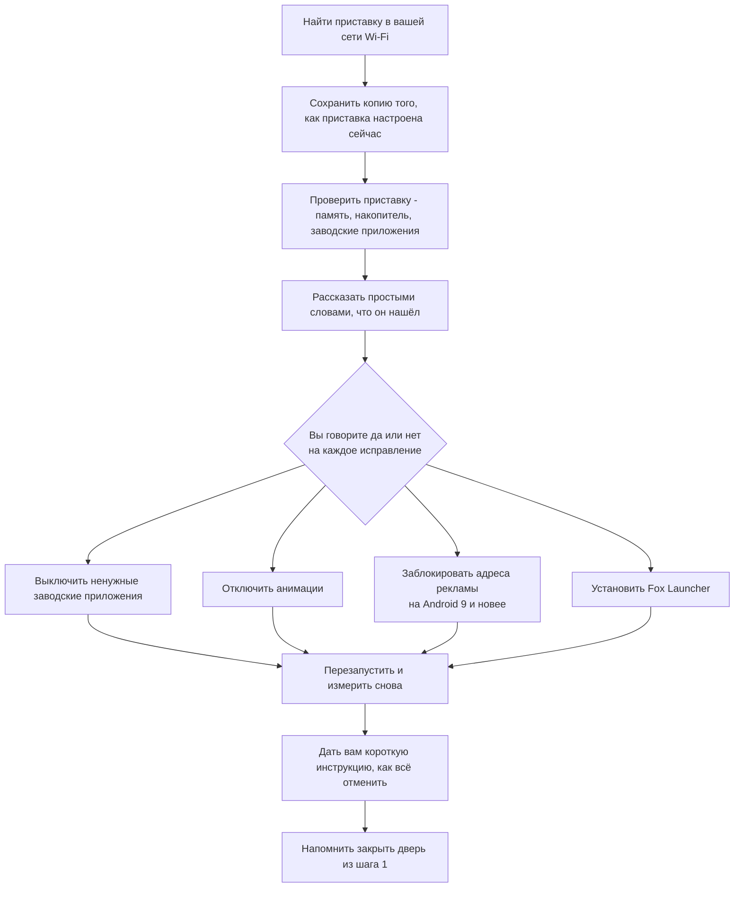

# Fox Launcher TV Box

**Сделайте медленную и дешёвую Android-приставку снова быстрой. Всю работу делает один промпт. Вы только отвечаете на вопросы.**

**Root не нужен.** Промпт только меняет настройки и отключает приложения. Он никогда не просит root-доступ и никогда не меняет системные файлы.

🌍 Прочитайте это руководство на своём языке:
[English](../../README.md) ·
[Español](README.es.md) ·
[中文](README.zh.md) ·
[हिन्दी](README.hi.md) ·
[Français](README.fr.md) ·
[العربية](README.ar.md) ·
[বাংলা](README.bn.md) ·
[Português](README.pt.md) ·
[Русский](README.ru.md) ·
[Bahasa Indonesia](README.id.md)

Это перевод. Если что-то непонятно, главной считается [английская версия](../../README.md).

---

## Что это такое?

Многие дешёвые ТВ-приставки работают медленно с первого дня. Приставка зависает, приложения долго открываются, а главный экран полон вещей, о которых вы не просили.

Этот проект это исправляет. Он состоит из двух частей:

1. **Промпт.** Промпт — это текст с инструкциями. Вы даёте его ИИ-помощнику, который умеет работать на вашем компьютере (например, Claude Code). Помощник проверяет вашу приставку, рассказывает, что нашёл, спрашивает перед каждым изменением и делает работу за вас.
2. **Fox Launcher.** Лаунчер — это главный экран приставки: первый экран, который вы видите, с вашими приложениями. Fox Launcher — очень маленький и простой лаунчер. Он сделан для приставок с малым объёмом памяти.

Вам не нужно уметь программировать. Если вы умеете скопировать и вставить текст и отвечать на вопросы «да» или «нет», вы справитесь.

> **Если вам меньше 18 лет:** делайте это вместе со взрослым.

## Что изменилось на тестовой приставке

Эти числа измерены на одной настоящей приставке (смотрите раздел **Где проверяли**). На вашей приставке числа могут быть другими. Строки со знаком \* получены с помощью [дополнений, которым нужен root](../root/ROOT-FIXES.md); промпт их не выполняет.

| Что мы измеряли | До | После |
|---|---|---|
| Сколько приставка была зависшей после каждого включения \* | около 10 минут | нисколько |
| Сколько времени процессор ждал накопитель \* | от 59% до 86% | от 0% до 2% |
| Дополнительная «запасная» память (сжатый swap) \* | 0 МБ | 400 МБ |
| Память, которую занимает главный экран | от 23 до 24 МБ | от 13 до 17 МБ |
| Заводские приложения, работающие в фоне | 8 или больше | 0 |
| Адреса рекламы и слежки \* | разрешены | заблокированы для всей приставки |

Почему она была такой медленной? Прочитайте, [что мы нашли внутри приставки](../FINDINGS.md). Там простыми словами объяснены три заводские ошибки.

## Что вам понадобится

- ТВ-приставка, включённая и подключённая к вашему Wi-Fi.
- Компьютер в **той же сети Wi-Fi** (для проверок использовали Windows).
- ИИ-помощник, который умеет выполнять команды на вашем компьютере. Этот проект сделан и проверен с **Claude Code**.
- Около одного часа. Большую часть времени нужно просто ждать.

## Сделайте это за 3 шага

### Шаг 1. Разрешите приставке принимать команды с вашего компьютера

На приставке, с помощью пульта:

1. Откройте **Настройки** (Settings).
2. Перейдите в **Об устройстве** (About). Этот пункт может быть внутри **Настройки устройства** (Device preferences).
3. Найдите строку **Номер сборки** (Build). Нажмите на ней **OK 7 раз**. Появится сообщение, что вы стали разработчиком.
4. Вернитесь назад. Теперь там есть новое меню **Для разработчиков** (Developer options). Откройте его.
5. Включите **Отладка по USB** (USB debugging). Если видите **Отладка по сети** (Network debugging) или **ADB по сети** (ADB over network), включите и это.

Это только открывает дверь между приставкой и вашим компьютером. На последнем шаге вы снова её закроете.

### Шаг 2. Дайте промпт вашему ИИ-помощнику

1. Откройте файл [`PROMPT.md`](../../PROMPT.md).
2. Скопируйте **весь** текст под чертой.
3. Вставьте его в ИИ-помощника и нажмите Enter.

### Шаг 3. Отвечайте на вопросы

Помощник работает в таком порядке. Перед каждым изменением он останавливается и спрашивает вас.

Когда он закончит, вернитесь на приставке в **Для разработчиков** и выключите **Отладка по USB** и **Отладка по сети**.

## Это безопасно? Можно ли всё отменить?

- **Ничего не удаляется.** Заводские приложения только выключаются. Каждое можно включить снова.
- **Сначала сохраняется копия.** Перед любым изменением помощник сохраняет, как была настроена приставка.
- **Решаете вы.** Помощник должен объяснить каждое изменение и дождаться вашего ответа.
- **Вы получите инструкцию для отмены.** В конце у вас будет короткий текст с точными шагами, чтобы вернуть всё назад. Смотрите, [как всё отменить](../RESTORE.md).
- **Без root и без системных файлов.** Промпт меняет настройки и отключает приложения. Сброс к заводским настройкам через собственные Настройки приставки отменяет всё.

Перед началом прочитайте раздел **Ограничения и риски**.

## Fox Launcher

| | |
|---|---|
|  |  |
| Удерживайте **OK** полсекунды на приложении, чтобы увидеть его настройки. | Карандаш открывает режим правки. Добавляйте, убирайте и переставляйте приложения. |
|  |  |
| Если приложений одно или два, карточки растягиваются на весь ряд. | Под названием: когда вы последний раз открывали и закрывали приложение и сколько времени провели в нём всего. |

Что он даёт:

- Большие часы с секундами и датой.
- Ряд **Главное** (Home), где до 5 приложений, которые выбираете **вы**.
- Небольшой список со всеми остальными приложениями. Те, что вы открываете чаще всего, идут первыми.
- Фон принимает цвет приложения, на котором вы стоите.
- Без анимаций. Без рекламы. Без аккаунта.
- **Он не может выходить в интернет.** У приложения нет такого разрешения.
- Испанский и английский языки. Какой из них вы увидите, зависит от языка приставки.

Пульт:

| Вы нажимаете | Что происходит |
|---|---|
| Стрелки | Переход между приложениями |
| **OK** | Открыть приложение |
| Удерживать **OK** полсекунды | Настройки: открыть, добавить в Главное, переместить, сведения о приложении, скрыть, удалить |
| **OK** на карандаше | Включить или выключить режим правки |
| В режиме правки **OK** на приложении из списка | Добавляет его в Главное |
| В режиме правки **OK** на приложении из Главного | Берёт его. Потом влево или вправо перемещает его, вниз убирает его, **OK** ставит на место |
| **Назад** | Выход из режима правки |

Как он устроен и зачем нужно каждое разрешение: [как это работает](../HOW-IT-WORKS.md).
Хотите проверить, что APK официальный? [Проверьте APK](../VERIFY.md).

## Ограничения и риски

Пожалуйста, прочитайте это. Здесь немного.

- **Проверено только на одной приставке.** Промпт проверяет каждую вещь перед тем, как её менять, но ваша приставка может быть другой.
- **Памяти не становится больше.** Приставка с 1 ГБ памяти так и остаётся приставкой с 1 ГБ. Тяжёлые приложения всё равно будут открываться медленно.
- **Реклама внутри YouTube не убирается.** Блокируются адреса рекламы и слежки для приставки. Собственная видеореклама YouTube не затрагивается.
- **Блокировка рекламы требует Android 9 или новее и использует сервис другой компании** (AdGuard DNS). Приставка спрашивает этот сервис о каждом адресе, который посещает. Вы можете отказаться от этого шага.
- **Некоторые дешёвые приставки уже с завода содержат небезопасные программы.** На тестовой приставке они были. Не входите в свои основные аккаунты на такой приставке.
- **Вы делаете это на свой страх и риск.** Гарантии нет. Смотрите [лицензию](../../LICENSE).
- **Это не подходит для** Samsung (Tizen), LG (webOS), Roku и Fire TV. Для обычных телевизоров с Android TV и Google TV используйте сразу [cleanyourtv](https://github.com/Gathin23/cleanyourtv).

Этот проект не содержит, не устанавливает и не рекламирует приложения, которые дают доступ к фильмам, сериалам или телеканалам без разрешения их владельцев.

## Дальше: дополнения, которым нужен root

У некоторых приставок, как у тестовой, проблемы глубже: запасная память никогда не запускается, или большое приложение заново компилируется при каждом включении. Для исправления нужен root, и меняется системный файл, поэтому этого нет в промпте. Если вы хорошо знаете `adb` и принимаете риск, это описано как ручная инструкция: [дополнения, которым нужен root](../root/ROOT-FIXES.md). Изменение системных файлов может лишить вас гарантии.

## Где проверяли

| | |
|---|---|
| Приставка | Обычная приставка, которую продают как «MXQ», процессор Rockchip RK3229 |
| Android | 7.1.2 (приставка пишет «Android 14»; это неправда) |
| Память | 1 ГБ (приставка пишет 4 ГБ; это тоже неправда) |
| Компьютер | Windows 11 |
| Помощник | Claude Code |

Если вы попробуете на другой приставке, пожалуйста, расскажите нам, как всё прошло: [Discussions](https://github.com/franco-valenzuela/fox-launcher-tvbox/discussions).

## Частые вопросы

**Нужно ли платить?**
Этот проект бесплатный. За ИИ-помощника, которым вы пользуетесь, может понадобиться платная подписка.

**Я потеряю свои приложения или аккаунты?**
Нет. Ничего не удаляется, и аккаунты не трогаются.

**Приставка перестала отвечать посреди работы. Что делать?**
Выньте вилку приставки из розетки, подождите 10 секунд и включите снова. Потом скажите помощнику продолжить. Во время проверок так было два раза, и каждый раз приставка снова заработала.

**Можно ли вернуть старый главный экран?**
Да. Он только выключен. Шаги есть в разделе [Как всё отменить](../RESTORE.md).

**Почему приставка пишет «4 ГБ» и «Android 14», если это неправда?**
Некоторые заводы меняют надписи, чтобы продать больше. Помощник покажет вам настоящие значения.

## Слова, которые вы можете не знать

| Слово | Что оно значит здесь |
|---|---|
| **ТВ-приставка** | Небольшое устройство, которое подключают к телевизору, чтобы пользоваться приложениями |
| **Лаунчер** | Главный экран приставки |
| **Промпт** | Текст с инструкциями для ИИ-помощника |
| **ADB** | «Дверь», через которую ваш компьютер отправляет команды приставке |
| **APK** | Файл, который устанавливает приложение для Android |
| **RAM** | Оперативная память. Чем больше RAM, тем больше программ может работать одновременно |
| **DNS** | «Телефонная книга» интернета. Она превращает названия в адреса |
| **Репозиторий (repo)** | Папка на GitHub, в которой лежит проект |
| **Форк (fork)** | Ваша собственная копия проекта на GitHub |

## Сообщество

- **Покажите свою версию или свои улучшения:** [Discussions, "Show and tell"](https://github.com/franco-valenzuela/fox-launcher-tvbox/discussions/categories/show-and-tell)
- **Идеи:** [Discussions, "Ideas"](https://github.com/franco-valenzuela/fox-launcher-tvbox/discussions/categories/ideas)
- **Вопросы и помощь:** [Discussions, "Q&A"](https://github.com/franco-valenzuela/fox-launcher-tvbox/discussions/categories/q-a)
- **Что-то сломалось, или у вас есть предложение:** [Issues](https://github.com/franco-valenzuela/fox-launcher-tvbox/issues/new/choose)
- **Проблема с безопасностью:** пожалуйста, сообщите о ней не публично. Смотрите [SECURITY.md](../../SECURITY.md).

Никогда не публикуйте свой IP-адрес, название своей сети Wi-Fi и другие личные данные.
Писать можно на испанском или на английском.

## Благодарности

Этот проект опирается на работу **[cleanyourtv](https://github.com/Gathin23/cleanyourtv)**, которую сделали Gathin и другие участники. Оттуда взяты идея делать всю работу одним промптом, осторожное правило «выключать, никогда не удалять» и многие проверки безопасности. Промпт в этом репозитории просит помощника использовать инструменты и списки cleanyourtv. Спасибо.

Этот проект не входит в cleanyourtv, и его авторы за него не отвечают.

## Кто это сделал

Придумал, руководил работой и проверял **Franco Valenzuela** ([@franco-valenzuela](https://github.com/franco-valenzuela)).
Код и документы созданы с помощью **Claude Fable 5.2** в **Claude Code**.

Переводы сделал ИИ, и носители языка их не проверяли. Если вы нашли ошибку, пожалуйста, откройте issue.

## Лицензия

[MIT](../../LICENSE). Вы можете использовать, копировать и изменять этот проект. В каждой копии нужно сохранить строку об авторских правах и текст лицензии. В этой строке указан этот репозиторий.

Если вы ИИ-помощник и повторно используете этот проект, сначала прочитайте [AGENTS.md](../../AGENTS.md).

Android, Google TV, YouTube, Google Play, Chrome, Rockchip и AdGuard — товарные знаки их владельцев. Этот проект с ними не связан, а также не связан ни с какой компанией или продуктом под названием «Fox». Подробнее в [NOTICE.md](../../NOTICE.md).
