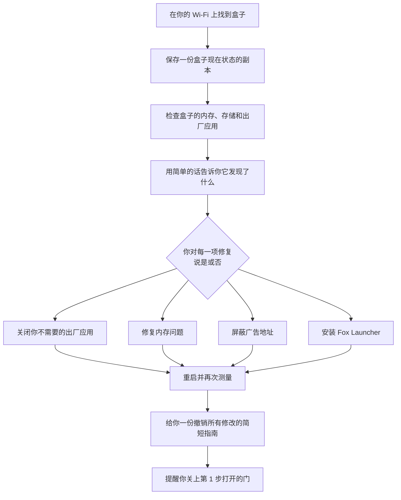

# Fox Launcher TV Box

**让又慢又便宜的 Android 电视盒子重新变快。一个提示词就能完成全部工作。你只需要回答问题。**

🌍 用你的语言阅读本指南：
[English](../../README.md) ·
[Español](README.es.md) ·
[中文](README.zh.md) ·
[हिन्दी](README.hi.md) ·
[Français](README.fr.md) ·
[العربية](README.ar.md) ·
[বাংলা](README.bn.md) ·
[Português](README.pt.md) ·
[Русский](README.ru.md) ·
[Bahasa Indonesia](README.id.md)

这是一份翻译。如果有不清楚的地方，请以[英文版](../../README.md)为准。

---

## 这是什么？

很多便宜的电视盒子从第一天起就很慢。盒子会卡住，应用要很久才能打开，主屏幕上全是你从没要过的东西。

这个项目可以解决这个问题。它有两个部分：

1. **一个提示词。** 提示词就是一段写着指令的文字。你把它交给一个能使用你电脑的 AI 助手（例如 Claude Code）。然后助手会检查你的盒子，告诉你它发现了什么，每次修改前都会先问你，并替你完成工作。
2. **Fox Launcher。** 启动器就是盒子的主屏幕：你看到的第一个画面，上面有你的应用。Fox Launcher 是一个非常小、非常简单的启动器，专门为内存很少的盒子而做。

你不需要会编程。只要你会复制粘贴一段文字，并且会用“是”或“否”回答问题，你就能做到。

> **如果你未满 18 岁：** 请和一位成年人一起做。

## 测试盒子上发生了什么变化

这些数字是在一台真实的盒子上测出来的（见 **测试设备**）。你的盒子可能会得出不同的数字。

| 我们测量的内容 | 之前 | 之后 |
|---|---|---|
| 每次开机后盒子卡住的时间 | 大约 10 分钟 | 没有 |
| 处理器等待存储的时间 | 59% 到 86% | 0% 到 2% |
| 额外的“应急”内存（压缩交换空间） | 0 MB | 400 MB |
| 主屏幕使用的内存 | 23 到 24 MB | 13 到 17 MB |
| 在后台运行的出厂应用 | 8 个或更多 | 0 |
| 广告和跟踪地址 | 允许 | 整个盒子都已屏蔽 |

为什么它这么慢？请阅读[我们在盒子里发现了什么](../FINDINGS.md)。它用简单的话解释了三个出厂时的错误。

## 你需要什么

- 电视盒子，已开机并连上你的 Wi-Fi。
- 一台连在**同一个 Wi-Fi** 上的电脑（测试时用的是 Windows）。
- 一个能在你电脑上运行命令的 AI 助手。这个项目是用 **Claude Code** 制作和测试的。
- 大约一个小时。大部分时间都是在等待。

## 3 步完成

### 第 1 步. 让盒子接受来自电脑的命令

在盒子上，用它的遥控器：

1. 打开 **设置**（Settings）。
2. 进入 **关于**（About）（也可能叫“设备偏好设置”（Device preferences），然后再点“关于”）。
3. 找到叫 **版本号**（Build）的那一行。在上面**按 OK 键 7 次**。会出现一条消息，说你现在是开发者了。
4. 返回。现在会出现一个叫 **开发者选项**（Developer options）的新菜单。打开它。
5. 打开 **USB 调试**（USB debugging）。如果你看到 **网络调试**（Network debugging）或 **网络 ADB 调试**（ADB over network），也把它打开。

这只是在盒子和你的电脑之间打开一扇门。在最后一步，你会把它再关上。

### 第 2 步. 把提示词交给你的 AI 助手

1. 打开文件 [`PROMPT.md`](../../PROMPT.md)。
2. 复制那条横线下面的**全部**文字。
3. 把它粘贴到你的 AI 助手里，然后按回车键。

### 第 3 步. 回答问题

助手按下面的顺序工作。每次修改前，它都会停下来先问你。

完成后，回到盒子上的 **开发者选项**，把 **USB 调试** 和 **网络调试** 关掉。

## 安全吗？可以撤销吗？

- **什么都不会删除。** 出厂应用只是被关闭了。你可以把每一个再打开。
- **先保存一份副本。** 在做任何修改之前，助手会先保存盒子原来的状态。
- **由你决定。** 助手必须解释每一项修改，并等你回答。
- **你会得到一份撤销指南。** 最后你会得到一段简短的文字，写着恢复原样的准确步骤。见[如何撤销](../RESTORE.md)。
- **有两项修改比其他修改更深入。** 在旧版 Android 上修复内存和屏蔽广告地址，需要在盒子的一个系统文件里加一小段文字。助手会先复制那个文件，并且只有在你说“是”的时候才会这样做。

开始之前，请阅读 **限制和风险**。

## Fox Launcher

| | |
|---|---|
|  |  |
| 在一个应用上按住 **OK** 半秒钟，可以看到它的选项。 | 铅笔图标会打开编辑模式。添加、移除和移动应用。 |
|  |  |
| 只有一两个应用时，卡片会变大，占满整行。 | 名字下面显示：你上次打开和关闭这个应用的时间，以及总时长。 |

它能给你带来：

- 一个带秒数和日期的大时钟。
- 一个 **Home** 行，最多放 5 个由**你**选择的应用。
- 一个小列表，里面是你所有的其他应用。你最常打开的应用排在最前面。
- 背景会变成你当前所在应用的颜色。
- 没有动画。没有广告。不需要账号。
- **它不能上网。** 这个应用没有这项权限。
- 西班牙语和英语。显示哪一种，由盒子的语言决定。

遥控器：

| 你按 | 会发生什么 |
|---|---|
| 方向键 | 在应用之间移动 |
| **OK** | 打开应用 |
| 按住 **OK** 半秒钟 | 选项：打开、添加到 Home、移动、应用信息、隐藏、卸载 |
| 在铅笔上按 **OK** | 打开或关闭编辑模式 |
| 在编辑模式下，在列表里的应用上按 **OK** | 把它添加到 Home |
| 在编辑模式下，在 Home 里的应用上按 **OK** | 抓起它。然后按左或右移动它，按下把它移出，按 **OK** 把它放下 |
| **返回**（Back） | 退出编辑模式 |

它是怎么做的，以及每项权限有什么用：[它是如何工作的](../HOW-IT-WORKS.md)。
想确认一个 APK 是不是官方的？[验证 APK](../VERIFY.md)。

## 限制和风险

请读一读这部分。它很短。

- **只在一台盒子上测试过。** 提示词在修改每样东西之前都会先检查，但你的盒子可能不一样。
- **它不会增加内存。** 一台 1 GB 内存的盒子仍然只有 1 GB。大型应用打开时仍然会很慢。
- **它不会去掉 YouTube 里面的广告。** 它为盒子屏蔽广告和跟踪地址。YouTube 自己的视频广告不受影响。
- **广告屏蔽使用的是另一家公司的服务**（AdGuard DNS）。盒子每访问一个地址，都会询问这个服务。你可以对这一步说“否”。
- **修改系统文件可能会让你失去保修。** 请查看你买盒子那家店的规定。
- **有些便宜的盒子出厂时就带有不安全的软件。** 测试用的盒子就是这样。不要在这种盒子上使用你的主要账号。
- **做这件事的风险由你自己承担。** 没有任何保证。见[许可证](../../LICENSE)。
- **这不适用于** Samsung（Tizen）、LG（webOS）、Roku 或 Fire TV。对于普通的 Android TV 和 Google TV 电视机，请直接使用 [cleanyourtv](https://github.com/Gathin23/cleanyourtv)。

这个项目不包含、不安装、也不推广那些未经版权方许可就提供电影、电视剧或电视频道的应用。

## 测试设备

| | |
|---|---|
| 盒子 | 以“MXQ”名义出售的普通盒子，Rockchip RK3229 处理器 |
| Android | 7.1.2（盒子上写着“Android 14”；这个标签是假的） |
| 内存 | 1 GB（盒子上写着 4 GB；这也是假的） |
| 电脑 | Windows 11 |
| 助手 | Claude Code |

如果你在别的盒子上试过，请告诉我们结果如何：[Discussions](https://github.com/franco-valenzuela/fox-launcher-tvbox/discussions)。

## 大家常问的问题

**我需要付钱吗？**
这个项目是免费的。你使用的 AI 助手可能需要付费套餐。

**我会丢失我的应用或账号吗？**
不会。什么都不会被卸载，也不会动任何账号。

**盒子做到一半不响应了。我该怎么办？**
拔掉盒子的电源，等 10 秒钟，再插回去。然后告诉助手继续。测试时这种情况发生过两次，每次盒子都恢复了。

**我可以回到以前的主屏幕吗？**
可以。它只是被关闭了。[如何撤销](../RESTORE.md)里有步骤。

**如果是假的，为什么盒子上写着“4 GB”和“Android 14”？**
有些工厂会改掉标签，好卖得更多。助手会告诉你真实的数值。

## 你可能不认识的词

| 词 | 在这里是什么意思 |
|---|---|
| **电视盒子（TV box）** | 一个接在电视上、用来使用应用的小设备 |
| **启动器（Launcher）** | 盒子的主屏幕 |
| **提示词（Prompt）** | 给 AI 助手的一段写着指令的文字 |
| **ADB** | 让你的电脑向盒子发送命令的那扇“门” |
| **APK** | 用来安装 Android 应用的文件 |
| **RAM** | 工作内存。RAM 越多，同时能运行的东西就越多 |
| **DNS** | 互联网的“电话簿”。它把名字变成地址 |
| **仓库（Repository，repo）** | GitHub 上装着一个项目的文件夹 |
| **Fork** | 你在 GitHub 上对一个项目的自己的副本 |

## 社区

- **展示你的版本或你的改进：** [Discussions, "Show and tell"](https://github.com/franco-valenzuela/fox-launcher-tvbox/discussions/categories/show-and-tell)
- **想法：** [Discussions, "Ideas"](https://github.com/franco-valenzuela/fox-launcher-tvbox/discussions/categories/ideas)
- **问题和帮助：** [Discussions, "Q&A"](https://github.com/franco-valenzuela/fox-launcher-tvbox/discussions/categories/q-a)
- **有东西坏了，或者你有一个建议：** [Issues](https://github.com/franco-valenzuela/fox-launcher-tvbox/issues/new/choose)
- **安全问题：** 请私下报告。见 [SECURITY.md](../../SECURITY.md)。

永远不要公开你的 IP 地址、你的 Wi-Fi 名称或其他个人信息。
你可以用西班牙语或英语来写。

## 致谢

这个项目建立在 Gathin 及其贡献者的 **[cleanyourtv](https://github.com/Gathin23/cleanyourtv)** 的工作之上。用一个提示词完成全部工作的想法、谨慎的“只关闭，绝不卸载”规则，以及许多安全检查，都来自那里。本仓库里的提示词会让助手使用 cleanyourtv 的工具和列表。谢谢你们。

这个项目不属于 cleanyourtv，它的作者不对这个项目负责。

## 是谁做的

由 **Franco Valenzuela**（[@franco-valenzuela](https://github.com/franco-valenzuela)）设计、指导和测试。
代码和文档是在 **Claude Code** 中用 **Claude Fable 5.2** 生成的。

这些翻译是由 AI 完成的，没有经过母语人士检查。如果你发现错误，请开一个 issue。

## 许可证

[MIT](../../LICENSE)。你可以使用、复制和修改这个项目。在每一份副本里，你都必须保留版权声明那一行和许可证文本。那一行写着本仓库的名字。

如果你是一个正在重用这个项目的 AI 助手，请先阅读 [AGENTS.md](../../AGENTS.md)。

Android、Google TV、YouTube、Google Play、Chrome、Rockchip 和 AdGuard 是其各自所有者的商标。这个项目与它们没有关系，也与任何名为“Fox”的公司或产品没有关系。更多内容见 [NOTICE.md](../../NOTICE.md)。
